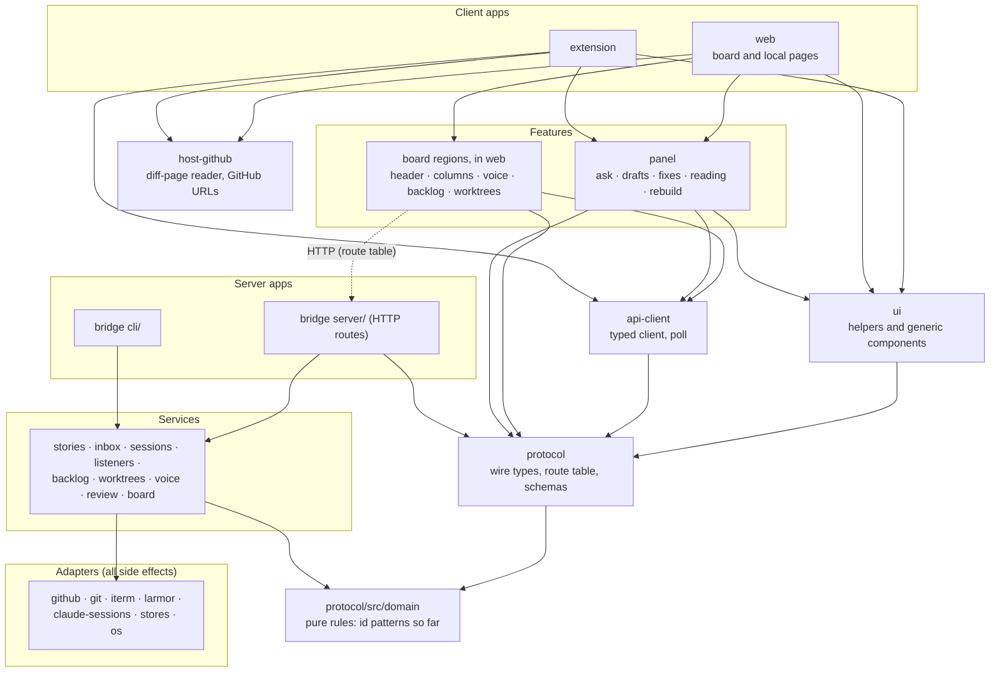

# ADR-15: Layered packages, with the protocol as the only place client and server meet

Decided 10/29. Built the same day, as of main at 0741c6c: `packages/protocol`, the server's layers, the `panel` and `web` packages, the region folders and the lint that enforces them. `ui`, `api-client` and `board-core` as packages were not built. ADR-16 says what was built and why those were left. `api-client` was built later (11/3): `client.ts` moved out of `protocol` into it, with the poll. `ui` was built on 11/4 (below).

## Context

The code was three packages split by where each one ran: `shared` (the panel and helpers), `bridge` (the server, the CLI, the board and the pages it serves) and `extension`. Most of "I can't trace it" is inside `bridge`, where HTTP routes, the stores, the board and the pages' own code share one folder tree, and in the contract between client and server, which has been implicit:

- The wire types lived in `shared/src/types.ts` (the `shared` package no longer exists: ADR-17), but the routes themselves did not. Each route's path, method and body were written in its handler (`String(body.x || '')`, `toInt`) and again in each of three clients' fetch helpers, as strings.
- Which key may reach which route was in two places that had to agree by hand: `boardKey: true` on a route and the `VIEW_KEY_MAY` list in `page-key.ts` (ADR-02).
- Nothing stopped a page from importing the server, or the other way round, except habit.

Two constraints from earlier ADRs shape the answer:

- **No build step for the bridge's pages** (ADR-14): the bridge serves `.ts` files type-stripped, so anything a page imports must be loadable that way, and a bare import such as `valibot` won't resolve in the browser.
- **The extension is bundled** by WXT, so it can import anything, but the panel in `shared` is both bundled and served, so it can only import by a path that works for both.

Eric chose the direction on 10/29: layered packages, the way a modern React monorepo is laid out.

## Decision

Layers, from the top. A package imports only layers below it. Apps know their host (`chrome.*`, GitHub's DOM, how to reach the bridge) and inject what features need as adapters. The diagram is what exists. `api-client` was built on 11/3 (`client.ts` and the poll). `ui` was built on 11/4 in two steps: the pieces the board, the local page, the panel and the extension share (the DOM and clipboard helpers and Start listening), then the generic Preact components (`Meter`, `Chip`, `CopyButton`, `Elapsed`), the popover menu, time text, `parseMarkup` and the markdown renderer, with `ui.css` for what they draw. A component that reads a region's state or calls a route stays in its region. It imports the protocol and the vendored Preact only, and the panel, the pages and the extension import it. Eric decided it should exist as a clean home for generic components although it has no runtime, dependency or outside consumer of its own, so it does not meet the package rule below: it is the one package made for tidiness, not for that rule.

Solid arrows point from importer to imported. The dotted arrow is the runtime HTTP call, not an import.

Rules:

- **Only apps know their host.** Features don't import each other. Client and server meet only at `protocol`. The board page reaches the board's services only at runtime, through HTTP and the bridge's routes. The two share only the `BoardData` types in protocol.
- **A package only when it has its own runtime, its own dependencies, or a consumer outside its layer** (`ui` is the one exception, by decision on 11/4). Everything else is a folder with a lint rule. So the domain is `protocol/src/domain/`, the server split is folders inside `bridge` (apps `server/` and `cli/`, then `services/`, then `adapters/`, where every side effect goes), and the feature regions are folders inside `web` (the board page) and `panel` that don't import each other. The CLI is a server-side app beside HTTP, over the services, in-process (ADR-05), and stays in `bridge`.
- **Enforced by lint and by compilers, not by habit.** `eslint.boundaries.mjs` has one entry per layer and region, and `packages/bridge/test/boundary-lint.test.ts` probes each rule with a violating file. Services, routes and the CLI may not run a program, write a file or reach the network, and no code that ships to a browser may import a Node built-in. protocol's own tsconfig has no DOM and no Node types. `yarn lint` runs in the pre-commit hook and in CI.

### What `packages/protocol` is

- **`types.ts`**: the wire types (moved from `shared`, which re-exports them until the imports move).
- **`routes.ts`**: the route table. Every call the bridge answers (57 of them), with its method, its path, which keys may make it (`token`, `token+board`, `token+page`, `token+page+view`, or `none`), the body it takes and the answer it gives. The bridge registers its handlers from the entries, and its dispatcher takes its lookups and the board-key rule from them. A test compares each story route's keys with `page-key.ts`'s read-only list, both ways, and calls every route with each kind of key.
- **`schemas.ts`**: a Valibot schema for each request body. The bridge checks every body against one after the key and story guards, so a bad body never changes which of 401, 403, 404, 413 or 415 answers. A body that isn't a JSON object is a 400.
- **`client.ts`**: a typed client over a transport each host supplies (the extension's service worker, a page's fetch with its key). It does no I/O itself. The extension's service worker also asks `matchRoute` before it adds the token, so it forwards only the 28 routes the extension calls (`extension/src/bridge-routes.ts`, checked against the code's uses by a test). It started here and became the `api-client` package (11/3) with the poll: `createPoll`, and `usePoll`, the board's Preact hook over it.
- **`domain/`**: pure rules, with no imports at all, not even the rest of the protocol (the protocol imports the domain). Only the id patterns are there so far.

### Source imports, not TypeScript project references

Packages import each other as source through `exports` (`./*` to `src/*.ts`) with `noEmit`, as `shared` does. Project references would need `composite` builds and declaration output for little that the lint rules, protocol's tsconfig and a test that walks its imports don't already give.

### Valibot: server only, not vendored

Pages and the extension build their requests from the route table's types, so they never run a schema, and the server is the one that has to distrust input. `routes.ts` takes its body types from `schemas.ts` with `import type`, which is erased, so a page that imports `routes.ts` never loads Valibot. The bridge serves only `routes`, `client` and `domain/patterns`, never `schemas.ts`, and a lint rule and tests keep it that way (`extension/test/no-valibot.test.ts` fails if the extension's imports reach it). Valibot is pinned to 1.5.0 (MIT) and is a dependency of `protocol`, so it is the bridge's first runtime dependency.

### Order

The plan was protocol, panel, web, ui, then the server split and board-core. What ran was protocol, the server split, the panel and web with their region folders, then Preact for the board page, each as a branch of its own. `ui` was built on 11/4, after the panel was on Preact; `board-core` is left (ADR-16).

### Options considered

| Option | Why not chosen |
|---|---|
| Stay at three packages and split files | Helps tracing, but nothing keeps client and server apart, and the route contract stays implicit. |
| A package for everything in the diagram | More manifests and build wiring than the code needs. A package is for its own runtime, dependencies or outside consumer. |
| Hono and its typed RPC client | Also types the three clients, but it means porting the guards (898 lines of tests) into middleware. The table gives the same types with no port. Still open if the guard port later looks worth it. |
| Validate in the pages too (vendor Valibot) | A build step or a vendored bundle, and more bytes on every page, for no security gain: the page isn't the one being protected. |
| TypeScript project references | See above. |

## Consequences

- A route's path, method, body, answer and who may call it are written once. Adding a route means adding an entry (its `keys` are required, so a route can't be added without deciding who may reach it), a schema if it takes a body, and a handler that calls `parseBody`.
- The pages and the extension get their calls typed for the first time, which found a few casts that hid mismatches.
- The panel imports the route table at run time (`packages/panel/src/bridge-options.ts`). The bridge rewrites the package specifier to an `/assets/` URL when it serves the module, and WXT bundles it for the extension. The panel's calls still come in through the `PanelHost` an app injects.
- Every future route touches `protocol`. That is the point, and also the cost.
- The read-only key's allowlist still lives in `page-key.ts`, checked against the table by a test, not derived from it.
- The bridge now has a runtime dependency.
- `web` and `bridge` once depended on each other as workspaces. The bridge still resolves web's files to serve them, but web's tests no longer import the bridge: the test helpers moved to `test-kit` and the two tests that start a bridge now live in `packages/bridge/test/web-assets.test.ts` (ADR-16). The cycle is broken.

## Open questions

1. When does `client.ts` become the `api-client` package: with the first poll hook, or the panel's move? Answered 11/3: with the first poll hook. The board page uses `usePoll`. The panel's tick, and the local page's, still have their own timers and could move onto `createPoll`.
2. Should `VIEW_KEY_MAY` be derived from the table's `keys`, so there is one list? A test checks the two against each other, both ways, with written-out lists.
3. Should answers be validated by the clients, and so should Valibot be vendored for the pages after all?
4. Which of the pure helpers move into the domain next? Only the id patterns are there. Candidates: relative time and `gateText` (they moved to the domain: ADR-17), ledger-line parsing (`services/ledger/ledger.ts`, which needs its types) and the board's column rules (`services/board/columns.ts`, also types).
5. `sub` is ignored by every story handler except questions and notes, so `POST /api/stories/<id>/approve/anything` still approves. It was so before the table. Should the table's `sub` be enforced?
