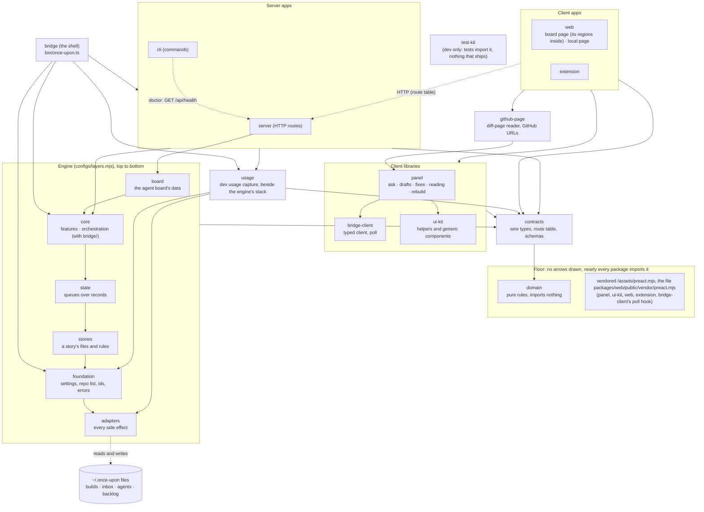

# ADR-15: Layered packages, with the contracts package as the only place client and server meet

Decided 10/29. Built the same day, as of main at 0741c6c: `packages/protocol`, the server's layers, the `panel` and `web` packages, the region folders and the lint that enforces them. `ui`, `api-client` and `board-core` as packages were not built. ADR-16 says what was built and why those were left. `api-client` was built later (11/3): `client.ts` moved out of `protocol` into it, with the poll. `ui` was built on 11/4 (below).

Since 11/5, four things in this ADR moved. The packages were renamed for what they now hold: `protocol` is `contracts` (it holds only the contract: route table, wire types and schemas), `api-client` is `bridge-client`, `ui` is `ui-kit`, and ADR-17's `host-github` is `github-page`. The domain has been its own package since 11/4. The server side, which the Decision below keeps as folders inside one `bridge` package, is packages (`core`, `server`, `cli`, with `bridge` as the shell: [ADR-20](adr-20-core-server-cli-split.md)) and core's folders are tiers ([ADR-21](adr-21-core-tiers-and-their-rules.md)): that part of the Decision is superseded. And `eslint.boundaries.mjs` and its tests are gone: dependency-cruiser is the one home for layer rules ([ADR-22](adr-22-dependency-cruiser-one-home-for-layer-rules.md)), which supersedes the "Enforced by lint" bullet. The text below uses the new names and says where the old ones were.

## Context

The code was three packages split by where each one ran: `shared` (the panel and helpers), `bridge` (the server, the CLI, the board and the pages it serves) and `extension`. Most of "I can't trace it" is inside `bridge`, where HTTP routes, the stores, the board and the pages' own code share one folder tree, and in the contract between client and server, which has been implicit:

- The wire types lived in `shared/src/types.ts` (the `shared` package no longer exists: ADR-17), but the routes themselves did not. Each route's path, method and body were written in its handler (`String(body.x || '')`, `toInt`) and again in each of three clients' fetch helpers, as strings.
- Which key may reach which route was in two places that had to agree by hand: `boardKey: true` on a route and the `VIEW_KEY_MAY` list in `page-key.ts` (ADR-02).
- Nothing stopped a page from importing the server, or the other way round, except habit.

Two constraints from earlier ADRs shape the answer:

- **No build step for the bridge's pages** (ADR-14): the bridge serves `.ts` files type-stripped, so anything a page imports must be loadable that way, and a bare import such as `valibot` won't resolve in the browser.
- **The extension is bundled** by WXT, so it can import anything, but the panel in `shared` is both bundled and served, so it can only import by a path that works for both.

Eric chose the direction on 10/29: layered packages, the way a modern React monorepo is laid out.

## Decision

Layers, from the top. A package imports only layers below it. Apps know their host (`chrome.*`, GitHub's DOM, how to reach the bridge) and inject what features need as adapters. The diagram is what exists on 11/6, kept to what the layers say: an arrow from a group means every box in it imports the target, the server side is the packages it became (the `bridge` shell at the top, the two apps under it, and the engine as seven packages, `adapters` at the bottom to `board` at the top, with `usage` beside them), and the domain and the vendored Preact sit in a floor with no arrows because nearly every package imports them. `bridge-client` was built on 11/3 as `api-client` (`client.ts` and the poll). `ui-kit` was built on 11/4 as `ui`, in two steps: the pieces the board, the local page, the panel and the extension share (the DOM and clipboard helpers and Start listening), then the generic Preact components (`Meter`, `Chip`, `CopyButton`, `Elapsed`), the popover menu, time text, `parseMarkup` and the markdown renderer, with `ui.css` for what they draw. A component that reads a region's state or calls a route stays in its region. It imports the contracts package, the domain and the vendored Preact only, and the panel, the pages and the extension import it. Eric decided it should exist as a clean home for generic components although it has no runtime, dependency or outside consumer of its own, so it does not meet the package rule below: it was the one package made for tidiness, not for that rule, until 11/5, when `core`, `server` and `cli` were made for layering, not for a runtime or a dependency ([ADR-20](adr-20-core-server-cli-split.md)).

Solid arrows point from importer to imported, and one arrow from a group stands for each box in it (`web` and `extension` each import the panel, `bridge-client`, `ui-kit`, `github-page` and the contracts package; the server and the CLI each import `core`, `usage` and the contracts package, the CLI for types only; only the server imports `board`; neither app imports `adapters`; the engine arrows between packages are drawn between neighbours, and each package may import any one below it (`configs/layers.mjs` is the order, and the `*-imports-only-below` rules in `configs/.dependency-cruiser.mjs` the check), so both apps also import `state`, `stories` and `foundation` directly, and the shell imports `foundation` (`bin/once-upon.mjs` takes the Node check from `node-version.mjs`); `usage` imports only `adapters` and `foundation`, and only the apps and the shell import it; `usage` and every engine package import the contracts package's types, and `state` alone takes values from it, from `files/schemas.ts` and `files/strict.ts`: the readers and kind constants of the shared files' formats). Changed 11/6: until then the diagram drew `core` as one box with five tiers over adapters, which was how the engine looked before ADR-24 split it into packages; `state` and `core` keep two tiers each inside (`records` under `queues`, `features` under `orchestration`), not drawn. The three dotted arrows are not imports. The first is HTTP from the clients: the board page and the local page call the bridge, and the extension does through its service worker, never from a content script. The second is the one call the CLI makes to the server: `once-upon doctor` asks `GET /api/health` (`packages/core/src/orchestration/bridge/doctor.ts:141` (`fetchHealth(`), over the fetch at `packages/adapters/src/bridge-health.ts:18` (`/api/health`)). The third is the shared state: the server and the CLI run as separate processes and meet in the files under `~/.once-upon` that the `adapters` package reads and writes (`builds.json` and `fixes.json` under a lock, and `inbox.jsonl`, `agents.jsonl` and `backlog.jsonl` as append-only logs that need none, by design: `packages/adapters/src/stores/fs/jsonl.ts:2` (`append-only JSONL log`)), so apart from the health check they do not call each other. `github-page` imports only the panel's `diff-types.ts` port, never `host.ts`, `overlay.ts` or a region. `domain` is imported by every package that ships except the shell, and the vendored Preact by the five named in its box. That file is served from `packages/web/public/vendor/preact.mjs`, so dependency-cruiser reports `panel`, `ui-kit`, `extension` and `bridge-client` importing `web`: the floor box stands for that file, not for a layer edge to the board and local pages. `test-kit` has no arrows because no shipped code may import it: every package's tests do, as a dev dependency.

Rules:

- **Only apps know their host.** Regions don't import each other (the board's and the panel's: the `*-regions-apart` rules). Client and server meet only at `contracts`. The board page reaches the board's services only at runtime, through HTTP and the bridge's routes. The two share only the `BoardData` types in the contracts package.
- **The CLI never calls the server.** Decided 11/5. The CLI and the HTTP app meet in two ways only, both through the engine packages: the CLI reads and writes the files the two share, and `serve` starts the server inside the CLI's own process (the process becomes the server; it is not a call). `once-upon` commands work with no bridge running. The one exception is `once-upon doctor`, whose health check asks the running bridge for `/api/health` (`adapters/src/bridge-health.ts`, imported only by `orchestration/bridge/doctor.ts`): it exists to test the road a browser takes. Until 11/5 `once-upon usage report` also asked a running bridge for fresh data with a signal; that is gone, and a report reads the last flush. Enforced in two places that need each other. dependency-cruiser sees imports only, so it says who may import the health check (`health-check-is-the-doctors`) and that the CLI and core never import the route table as a value (`cli-and-core-have-no-route-table`, a type such as `RouteName` is fine; the CLI also may not import the server or `bridge-client`: `cli-not-http`, `bridge-not-the-client`). A graph cannot see a `fetch`, a socket, a signal or a program run as `curl`, so `packages/bridge/test/cli-never-calls-server.test.ts` is the real guard: it scans every source the CLI process can run and fails on any file that could reach the bridge, unless the test's list names it and says why it is not a call. A new adapter that calls the bridge fails there, not in depcruise.
- **The formats of the files the CLI and the bridge share are in the contracts package.** Five files under `~/.once-upon` are written by one process and read by the other: `agents.jsonl`, `backlog.jsonl` and `inbox.jsonl` (events and entries, appended) and `builds.json` and `fixes.json` (records by key, rewritten whole under a lock). Their formats are Valibot schemas in `contracts/src/files/schemas.ts`, and the stores in `state` and `adapters` read and write through them, so neither app has a copy. A schema accepts what older code wrote and later code may add (a field of the wrong type reads as absent, an unknown field is kept), and a line or record it refuses is skipped by a reader, never dropped from a file that is rewritten. Other state files (`finished-agents.json`, `handed.json`, `asking.json`, `listeners/`, `stories.json`, `cursors/`, `worktree-cleanups.jsonl`) are not under a schema.
- **A package only when it has its own runtime, its own dependencies, or a consumer outside its layer** (`ui` was the one exception, by decision on 11/4; `core`, `server` and `cli` became three more on 11/5, see below). Everything else is a folder with a lint rule. So the domain was `protocol/src/domain/` (a package since 11/4), the server split was folders inside `bridge` (apps `server/` and `cli/`, then `services/`, then `adapters/`, where every side effect goes), and the feature regions are folders inside `web` (the board page) and `panel` that don't import each other. The CLI is a server-side app beside HTTP, over the services, in-process (ADR-05), and stays in `bridge`. **Superseded by [ADR-20](adr-20-core-server-cli-split.md) (11/5) and [ADR-24](adr-24-engine-packages-by-layer.md) (11/5, the engine as seven packages):** the CLI is its own package, `cli`, and the server-side folders are packages: `server` and `cli` over the engine, with `bridge` as the shell (ADR-20), and the engine is seven packages by layer, `adapters` to `board` with `usage` beside them, where `state` and `core` keep two tiers each (ADR-24). ADR-20 and ADR-21 had `core` over `adapters/` as one package with five tiers of services. The decision to make them packages was Eric's, on 11/4, for the lint and the tiers, not for a runtime or a dependency.
- **Enforced by lint and by compilers, not by habit.** As decided on 10/29, `eslint.boundaries.mjs` had one entry per layer and region, with `boundary-lint.test.ts` probing each rule, and `configs/.dependency-cruiser.mjs` checked the same layers over the whole import graph, with a `layer-rules-agree` test that failed when the two files disagreed. **Superseded 11/4 (8553da5): dependency-cruiser is the one home for layers, regions and cycles, and `eslint.boundaries.mjs` and the agree test are gone** (ADR-22). ESLint keeps style and `configs/eslint.side-effects.mjs`: only an adapter runs a program, writes a file or reaches the network, and dependency-cruiser's `browser-no-node` rule keeps Node built-ins out of code that ships to a browser (not ESLint). The contracts package's own tsconfig has no DOM and no Node types. `yarn lint` runs in the pre-commit hook and in CI.

### What `packages/contracts` is (`packages/protocol` until 11/5)

- **`types.ts`**: the wire types (moved from `shared`, which re-exports them until the imports move). On 11/4 it became an index over one types file per area (`story/`, `panel/`, `review/`, `bridge/`, `github/`, `board/`), and `routes.ts` and `schemas.ts` likewise over the area files, with `route-kit.ts` and `schema-kit.ts` for what they share.
- **`routes.ts`**: the route table. Every call the bridge answers (64 of them on 11/4, 66 on 11/5), with its method, its path, which keys may make it (`token`, `token+board`, `token+page`, `token+page+view`, or `none`), the body it takes and the answer it gives. The bridge registers its handlers from the entries, and its dispatcher takes its lookups and the board-key rule from them. A test compares each story route's keys with `page-key.ts`'s read-only list, both ways, and calls every route with each kind of key.
- **`schemas.ts`**: a Valibot schema for each request body. The bridge checks every body against one after the key and story guards, so a bad body never changes which of 401, 403, 404, 413 or 415 answers. A body that isn't a JSON object is a 400.
- **`client.ts`**: a typed client over a transport each host supplies (the extension's service worker, a page's fetch with its key). It does no I/O itself. The extension's service worker also asks `matchRoute` before it adds the token, so it forwards only the routes the extension calls (30 on 11/4, listed in `extension/src/bridge-routes.ts` and checked against the code's uses by a test). It started here and became the `api-client` package (11/3, `bridge-client` since 11/5) with the poll: `createPoll`, and `usePoll`, the board's Preact hook over it.
- **`files/schemas.ts`** (11/5): the formats of the five files the CLI and the bridge share (see the rule above), in the `files/` area folder like the other areas' `schemas.ts`, so the bridge never serves it to a page and no page may import it.
- **`domain/`** (moved to `packages/domain`, `@once-upon-a-diff/domain`, on 11/4 by decision: the contracts package imports it, and it imports nothing): pure rules, with no imports at all, not even the rest of the contracts package (which imports the domain). It started with the id patterns. On 11/4 it had 13 modules: `patterns`, `html`, `text`, `time`, `choice`, `chapters`, `line-refs`, `pr-key`, `bridge-port` (most moved from `shared`, ADR-17), and `lane-key`, `parts` (ADR-19), `error-code` and `usage-actions` (ADR-18). It has 15 on 11/5, with `fix-notes` and `github-urls`.

### Source imports, not TypeScript project references

Packages import each other as source through `exports` (`./*` to `src/*.ts`) with `noEmit`, as `shared` does. Project references would need `composite` builds and declaration output for little that the lint rules, the contracts package's tsconfig and a test that walks its imports don't already give.

### Valibot: the bridge's side only, not vendored

Pages and the extension build their requests from the route table's types, so they never run a schema, and the server is the one that has to distrust input. Since 11/5 `core` also runs Valibot, through the contracts package's file formats (`files/schemas.ts`), so the CLI loads it too; core has no Valibot dependency of its own, because the schemas come with readers that return the value or null. `routes.ts` takes its body types from `schemas.ts` with `import type`, which is erased, so a page that imports `routes.ts` never loads Valibot. The bridge serves only the routes (`routes`, `route-kit` and each area's `routes`), `client` and the domain, never a schema file, and a lint rule and tests keep it that way (`extension/test/no-valibot.test.ts` fails if the extension's imports reach it). Valibot is pinned to 1.5.0 (MIT) and is a dependency of `contracts` (of `protocol` until 11/5), so it is the bridge's first runtime dependency.

### Order

The plan was protocol, panel, web, ui, then the server split and board-core. What ran was protocol, the server split, the panel and web with their region folders, then Preact for the board page, each as a branch of its own. `ui` was built on 11/4, after the panel was on Preact; `board-core` is left (ADR-16). The server split ran again on 11/5, as packages (ADR-20).

### Options considered

| Option | Why not chosen |
|---|---|
| Stay at three packages and split files | Helps tracing, but nothing keeps client and server apart, and the route contract stays implicit. |
| A package for everything in the diagram | More manifests and build wiring than the code needs. A package is for its own runtime, dependencies or outside consumer. |
| Hono and its typed RPC client | Also types the three clients, but it means porting the guards (898 lines of tests) into middleware. The table gives the same types with no port. Still open if the guard port later looks worth it. |
| Validate in the pages too (vendor Valibot) | A build step or a vendored bundle, and more bytes on every page, for no security gain: the page isn't the one being protected. |
| TypeScript project references | See above. |

## Consequences

- A route's path, method, body, answer and who may call it are written once. Adding a route means adding an entry (its `keys` are required, so a route can't be added without deciding who may reach it), a schema if it takes a body, and a handler that calls `parseBody`.
- The pages and the extension get their calls typed for the first time, which found a few casts that hid mismatches.
- The panel imports the route table at run time (`packages/panel/src/host/bridge-options.ts`). The bridge rewrites the package specifier to an `/assets/` URL when it serves the module, and WXT bundles it for the extension. The panel's calls still come in through the `PanelHost` an app injects.
- Every future route touches `contracts`. That is the point, and also the cost.
- The read-only key's allowlist still lives in `page-key.ts`, checked against the table by a test, not derived from it.
- The bridge now has a runtime dependency.
- `web` and `bridge` once depended on each other as workspaces. The bridge still resolves web's files to serve them, but web's tests no longer import the bridge: the test helpers moved to `test-kit` and the two tests that start a bridge now live in `packages/bridge/test/web-assets.test.ts` (ADR-16). The cycle is broken.

## Open questions

1. When does `client.ts` become the `api-client` package: with the first poll hook, or the panel's move? Answered 11/3: with the first poll hook. The board page uses `usePoll`. The panel's tick, and the local page's, moved onto `createPoll` on 11/4 (e9dc085).
2. Should `VIEW_KEY_MAY` be derived from the table's `keys`, so there is one list? A test checks the two against each other, both ways, with written-out lists.
3. Should answers be validated by the clients, and so should Valibot be vendored for the pages after all?
4. Which of the pure helpers move into the domain next? Candidates: relative time and `gateText` (they moved to the domain: ADR-17), ledger-line parsing (gone: the board reads the registry only, 11/5) and the board's column rules (`packages/board/src/columns.ts`, also types).
5. `sub` is ignored by every story handler except questions and notes, so `POST /api/stories/<id>/approve/anything` still approves. It was so before the table. Should the table's `sub` be enforced?
