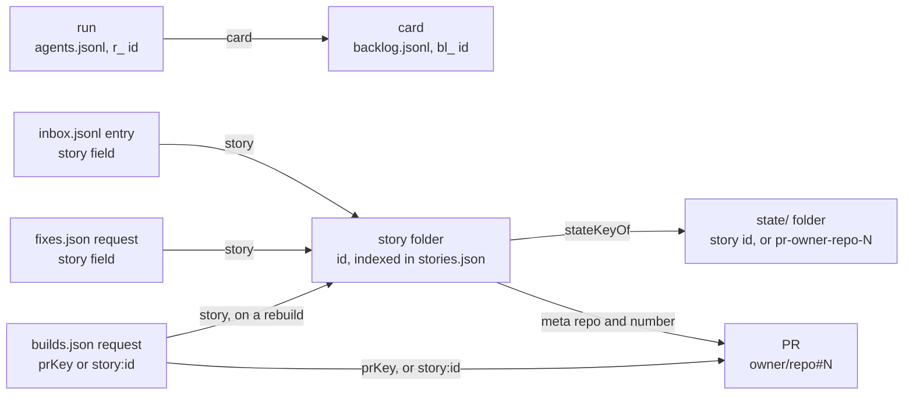

# ADR-26: The data model: every store under `~/.once-upon`, how they join, what is checked at write, and the rules

Decided 11/6 by Eric (one ADR for how a card and its data are managed). Written 11/6 as documentation: the commit that adds this file changes no code, and the file is descriptive of the code on main at that commit. It gathers what was spread over [ADR-04](adr-04-json-files-as-store.md) (JSON files as the store), the shared-files bullet of [ADR-15](adr-15-layered-packages-and-protocol.md) and [ADR-25](adr-25-the-card-owns-its-runs.md) (the card owns its runs, and the write checks), and it records three things built on 11/6 with no ADR: the id module, doctor's joins and `stateFile` and `Inbox` no longer writing on a read. Where it differs from ADR-04's list of files, this one is the newer; [`state-map.md`](../state-map.md) still has the per-file lifetime and race notes.

## Context

Eric, 11/6: one ADR for how a card and its data are managed, and all the data. The facts were in four places. ADR-04 says what the files are and how they are written, and predates the card model. ADR-15 lists five shared files. ADR-25 says how a run joins its card and what a write refuses. And the id module (`packages/domain/src/ids.ts`), doctor's joins (`packages/core/src/orchestration/bridge/doctor-joins.ts`) and the split between `stateFile` and `stateFileToWrite` had no ADR at all. A reader who asks "what is this key, who writes it, and what joins it to that other file" had to read the code.

## Decision

The data is JSON and JSONL files under `<home>` (`~/.once-upon`, moved by `ONCE_UPON_HOME`: `packages/foundation/src/settings.ts:74` (`homeDir`)), with no database. There are five groups of store below. What every store has in common is under The rules.

### 1. The shared files: one schema, written by both apps

Five files are written by one process and read by the other, so their format is a contract (`packages/contracts/src/files/schemas.ts:1-18`). Every writer checks a line or record before it writes it (see What is checked at write). An agent run's identity is `sid8:name` plus a run id; a card's is its `bl_` id.

| File | Format and what a line or record is | Key, and the `ids.ts` function that builds it | Writers (adapter, and the app that calls it) | Readers | Append or lock rule | Schema |
|---|---|---|---|---|---|---|
| `agents.jsonl` | JSONL, one event a line: `start`, `state`, `beat`, `finish`. Folded into runs on read (`packages/state/src/records/agents/events.ts:60` (`foldAgentEvents`)) | An agent is `sid8:name`, `agentId` (`packages/domain/src/ids.ts:96` (`agentId`)); a run is `r_` and 10 hex, minted by `newRunId` (`packages/foundation/src/ids.ts:15` (`newRunId`)) and read back through `RUN_ID_RE` (`packages/domain/src/ids.ts:109` (`RUN_ID_RE`)); `card` is the card's id | `appendAgentEvent` (`packages/adapters/src/stores/agents-file.ts:12` (`appendAgentEvent`)), called by `AgentRegistry` (`packages/state/src/records/agents/registry.ts:169` (`private append(`)): the CLI (`agent`, `editor`) and the bridge (the board's Finish, `packages/board/src/board.ts:628` (`.finish(name`)) | The board (`readAgents`, `packages/state/src/records/agents/read.ts:14` (`readAgents`)), `agent list`, `backlog land`, doctor | Append only, no lock, never rewritten (`packages/adapters/src/stores/fs/jsonl.ts:17` (`appendLogLine`)) | `AgentEventSchema` (`packages/contracts/src/files/schemas.ts:101` (`AgentEventSchema`)), strict `packages/contracts/src/files/strict.ts:134` (`strictAgentEvent`) |
| `backlog.jsonl` | JSONL, one event a line: `add`, `edit`, `start`, `assign`, `claim`, `done`, `hold`, `someday`, `move`, `drop`, `reopen`. Folded into cards on read (`packages/state/src/queues/backlog/backlog.ts:131` (`foldBacklog`)) | A card is `bl_` and a time-and-random suffix, minted by `newId('bl')` (`packages/state/src/queues/backlog/backlog.ts:289` (`newId('bl')`), `packages/foundation/src/ids.ts:8` (`newId`)); a card's `repo` is compared by `repoKey` | `appendBacklogEvent` (`packages/adapters/src/stores/backlog-file.ts:12` (`appendBacklogEvent`)), called by `BacklogStore` (`packages/state/src/queues/backlog/backlog.ts:265` (`private append(`)): the CLI (`backlog`) and the bridge (the board's Add, Edit, Move, Drop, Assign and Someday: `packages/board/src/board.ts:168` (`this.backlog.add`)) | The board, `backlog list\|show\|land`, doctor | Append only, no lock, never rewritten; the adapter stamps `at` | `BacklogEventSchema` (`packages/contracts/src/files/schemas.ts:161` (`BacklogEventSchema`)), strict `packages/contracts/src/files/strict.ts:185` (`strictBacklogEvent`) |
| `inbox.jsonl` | JSONL, one entry a line: `question`, `answer`, `note`, `fix`, `read`, `approved`, `review_comment`, `comment`. Never folded: readers filter by `story` and tail from a byte offset | An entry's id is the first letter of its type and a time-and-random suffix (`packages/state/src/queues/requests/inbox.ts:92` (`newId(entry.type`)); its `story` is a story id (below) | `Inbox.append` (`packages/state/src/queues/requests/inbox.ts:109` (`append<E`)), through `appendText` (`packages/adapters/src/stores/fs/files.ts:28` (`appendText`)): the bridge (questions, reads, drafted and posted comments, `note` entries added, updated and deleted (`packages/state/src/queues/requests/fixes.ts:519` (`action: 'updated'`)), `fix` entries sent (`packages/state/src/queues/requests/fixes.ts:253` (`action: 'sent'`)) and `approved` entries from the page's Approve button (`packages/server/src/routes/local-story.ts:68` (`approveStory(app.stories`))) and the CLI (`ask`, `answer`, `fixed`, `approve`, `drafts`) | The bridge (whole file, every pulse), `wait` and `inbox --unread` (from a cursor), doctor | Append only, no lock, never rewritten | `InboxEntrySchema` (`packages/contracts/src/files/schemas.ts:236` (`InboxEntrySchema`)), strict `packages/contracts/src/files/strict.ts:257` (`strictInboxEntry`) |
| `builds.json` | JSON object of build requests by key | A PR's is `prKey(repo, number)`, lower case; a local story's rebuild is `storyBuildKey(id)`, `story:<id>` (`packages/state/src/queues/requests/builds.ts:433` (`const key = github ? prKey`), `packages/domain/src/ids.ts:39` (`prKey`), `packages/domain/src/ids.ts:58` (`storyBuildKey`)); the request's own id is `b_...` | `RequestQueue.update` (`packages/state/src/queues/requests/queue.ts:114` (`update<T>`)): the bridge (Build story, Update, Rebuild: `packages/server/src/routes/builds.ts:40` (`app.builds.request`)) and the CLI (`wait` claims, `publish`, `local`, `done`) | The bridge, the board, `wait`, doctor | A locked read-modify-write, `builds.json.lock`, `{pid, at}`, taken over when stale (`packages/adapters/src/stores/fs/lock.ts:82` (`withLock`)); atomic write | `BuildSchema` (`packages/contracts/src/files/schemas.ts:327` (`BuildSchema`)), strict `packages/contracts/src/files/strict.ts:279` (`strictBuild`) |
| `fixes.json` | JSON object of fix requests (a batch of notes handed to a session) by request id | The request id, `f_...` (`packages/state/src/queues/requests/fixes.ts:224` (`newId('f')`)); `story` is a story id | The same queue: the bridge (send, take back, auto-send) and the CLI (`wait` claim, `fixed`) | The bridge, the board, `wait` | The same lock, `fixes.json.lock`; every story's `notes.json` is written under it too (`packages/state/src/queues/requests/fixes.ts:69` (`const locked`)) | `FixRequestSchema` (`packages/contracts/src/files/schemas.ts:371` (`FixRequestSchema`)), strict `packages/contracts/src/files/strict.ts:315` (`strictFixRequest`) |

The two log files that fold (`agents.jsonl`, `backlog.jsonl`) and the one that does not (`inbox.jsonl`) are the append-only kind: the CLI (in process) and the bridge both append, and nothing is lost to a crossed rewrite (`packages/adapters/src/stores/fs/jsonl.ts:2` (`append-only JSONL log`)). The two queues are rewritten whole, so they take the lock, and a write carries a record the schema refuses, or a field it does not list, through untouched (`packages/state/src/queues/requests/queue.ts:22` (`A record as it is on disk`)).

### 2. Stories: the index, the folders and the state folders

| Store | Format and key | Writers | Readers | Rule | Schema |
|---|---|---|---|---|---|
| `stories.json` | JSON `{story id: folder}`. The id is a PR story's `storyIdForPr` (`packages/domain/src/ids.ts:72` (`storyIdForPr`): the repo as GitHub spells it, dashed, with the number, kept in case so a rebuild is the same story) or a local story's `slug('local-<name>-<branch>')` (`packages/stories/src/local-story.ts:146` (`slug(`)) | `indexStory` (`packages/stories/src/placement.ts:86` (`indexStory`)), from `storyDirFor` (`packages/stories/src/placement.ts:97` (`storyDirFor`)), which `publish` (`packages/core/src/features/publishing/publish.ts:91` (`storyDirFor(home, id`)) and `createLocalStory` (`packages/stories/src/local-story.ts:150` (`storyDirFor(home, id`)) call: the CLI (`publish`, `local`) and the bridge, from the board's Review card button (`packages/server/src/routes/board.ts:135` (`made = reviewBranch`)) | `StoryStore.dirs` (`packages/stories/src/store.ts:40` (`dirs()`)), the board, `wait`, doctor | Atomic rewrite, no lock, last writer wins, never pruned. Only a story placed in a checkout is indexed; one in `<home>/<id>` is found by scanning (`packages/stories/src/store.ts:53` (`childDirs(this.home)`)) | Not under a schema |
| Story folders | `<checkout>/.once-upon/<id>/` (or `<home>/<id>/`): `chapters.json`, `file-map.json`, `meta.json`, `skeleton.json` (`packages/core/src/features/publishing/publish.ts:109` (`noteSkeleton(dest`)) and, for a local story, `local.diff`, `local-w.diff` (`packages/stories/src/local-diff.ts:19` (`local-w.diff`)) and a storyless review's `storyless.json` (`packages/stories/src/local-story.ts:260` (`STORYLESS_FILE`)) | `publish` and `local`: the CLI; the bridge too, from the board's Review card button (the same `createLocalStory`, which also writes `storyless.json`); `refreshLocal` and the whitespace diff are the bridge's | The bridge, the skills | Atomic, a story's own files | Not under a schema |
| `state/<key>/` | One folder per key, one JSON file per concern: `notes.json`, `viewed.json`, `position.json`, `ui.json`, `working.json`, `questions.json`, `reviewed.json`, `approved.json`, `merged.json`, `agent.json`, `seen.json`, `fix-settings.json`, `pr-draft.json`, `drafts.json`, `read.json`. The key is the story id for all of them except `drafts.json` and `read.json`, which are under `stateKeyOf` (`packages/stories/src/meta.ts:100` (`stateKeyOf`)): a PR story's `pr-<owner>-<repo>-<N>` from `stateKeyForPr` (`packages/domain/src/ids.ts:76` (`stateKeyForPr`)), lower case, so a re-told story keeps them | The bridge (the panel and board routes) and the CLI (`bind`, `working`, `fixed`, `pr-draft`), always through `stateFileToWrite` | The same, through `stateFile` | Atomic rewrite of one small file, no lock (`notes.json` under the fixes lock) | Not under a schema |

### 3. Requests, listeners and what the board remembers

These are written by one or both apps and read by the bridge or the CLI, with no schema. Each is atomic and unlocked unless the rule says so.

| File | Key, and the function | Writers | Readers | Rule |
|---|---|---|---|---|
| `cursors/<consumer>.json` | The consumer's name: `story-<id>`, `repoListenerName` (`packages/domain/src/ids.ts:80` (`repoListenerName`), chosen at `packages/core/src/features/listeners/wait.ts:100` (`function consumerOf`)) or `--consumer`. `{offset, at}`, a byte offset into `inbox.jsonl` | `Inbox.setCursor` (`packages/state/src/queues/requests/inbox.ts:202` (`setCursor(`)): the CLI (`wait`, `inbox --unread`) | The same reader | Atomic; a reader's own position is the one write a read makes. Never pruned |
| `cursors/<consumer>.deferred.json` | The same consumer; a list of question ids a repo wait left to a story listener | `wait` | `wait` | Atomic |
| `listeners/<consumer>.json` | The same consumer name; `{consumer, pid, state, at, repo?, story?, ...}` | `beat` (`packages/state/src/records/listeners/listeners.ts:68` (`export function beat(`)): `wait`, every 5 s | The bridge, the board, doctor | Atomic; live while a beat is under `WAITING_FRESH_MS` with its pid alive, never deleted |
| `handed.json` | A question id (the inbox entry's); `{consumer, at, via?}` | `noteHanded` (`packages/state/src/queues/requests/conversation.ts:149` (`noteHanded`)): `wait` | The bridge, `answer` | A locked read-modify-write, `handed.json.lock` (`packages/state/src/queues/requests/conversation.ts:154` (`updateJson<Handed`)) |
| `asking.json` | A question id; `{note, at, by}` | `noteAsking` (`packages/state/src/queues/requests/conversation.ts:217` (`noteAsking`)): the CLI (`asking`), cleared by `answer` | The bridge | Atomic rewrite, no lock |
| `checkouts.json` | `repoKey(repo)`, lower case; the checkout's path (`packages/foundation/src/repos.ts:199` (`seenCheckout`), `packages/domain/src/ids.ts:31` (`repoKey`)) | `seenCheckout`: the CLI (`wait --repo`, `local`) and the bridge, on a local story's load (`packages/server/src/routes/story.ts:32` (`seenCheckout(app.home`)) and when the board's Review card makes a local story (`packages/stories/src/local-story.ts:153` (`seenCheckout(home, origin`)) | `checkoutFor` (`packages/foundation/src/repos.ts:274` (`checkoutFor`)), the typed-repo check, doctor | Atomic read-modify-write, no lock, last writer wins, never pruned |
| `listener-history.json` | `repoKey(repo)`; `{repo, consumer, started_at, last_seen}` | `noteListener` (`packages/state/src/records/listeners/history.ts:42` (`noteListener`)), called by a repo-wide listener's heartbeat (`packages/state/src/records/listeners/listeners.ts:83` (`noteListener(home, extra.repo`)) | The board (it only reads) | Atomic; entries over 7 days are dropped on read |
| `listener-stops.json` | `repoKey(repo)`; a time in ms | `requestStop` (`packages/core/src/features/listeners/auto-stop.ts:180` (`requestStop`)): the board | `wait --repo` | Atomic |
| `finished-agents.json` | `agentId`, `sid8:name`; the time of the board's Finish | `markFinished` (`packages/adapters/src/stores/finished-agents.ts:29` (`markFinished`)): the bridge (`packages/board/src/board.ts:637` (`markFinished(`)) | The board | Atomic; entries over a week are dropped on the next write |
| `github-answers.json` | `branchKey` and `prKey` in two maps (`packages/adapters/src/stores/github-answers.ts:28` (`<repo lower>@<branch>`)), each with the time GitHub answered | `writeGithubAnswers` (`packages/adapters/src/stores/github-answers.ts:106` (`writeGithubAnswers`)): the bridge's GitHub watcher | The watcher, at start | Atomic; a version field; entries over a week are dropped on read and write |
| `worktrees.json` | `{at, items: [worktree facts]}`, each fact carrying its path (`packages/state/src/records/worktrees/worktrees.ts:367` (`items: [...this.items.values()]`)) | The board's scanner in the bridge (`packages/state/src/records/worktrees/worktrees.ts:286` (`worktrees.json`)) | The scanner, at start | Atomic, overwritten each scan |
| `worktree-cleanups.jsonl` | One line a Clean up attempt, with the line that restores the branch | The bridge (`packages/state/src/records/worktrees/worktree-clean.ts:128` (`worktree-cleanups.jsonl`)) | People | Append only, never trimmed |

### 4. Settings and the process's own files

| File | Format and key | Writers | Readers | Rule |
|---|---|---|---|---|
| `config.json` | JSON `{port, token, ...settings}`, mode 600 | `loadConfig` (`packages/foundation/src/settings.ts:98` (`loadConfig`)), `token --rotate`, a person | Every process (`readSettings`) | Atomic; a file that is not JSON is copied aside before a fresh one is made (`packages/foundation/src/settings.ts:115` (`unreadable`)). The `ship` rules and the `checkout_dirs` are here |
| `prefs.json` | JSON `{hideWhitespace, diffView, layout?}` | `writePrefs` (`packages/foundation/src/settings.ts:436` (`writePrefs`)): the bridge | The bridge, the pages | Atomic |
| `bridge.json` | JSON `{pid, port, token fingerprint}` | `writeBridgeFile` (`packages/adapters/src/stores/bridge-file.ts:23` (`writeBridgeFile`)), removed on close when it is the bridge's own | `once-upon local`, doctor | Atomic |
| `extension-seen.json` | JSON `{at, origin}` | The bridge (`packages/core/src/orchestration/bridge/bridge.ts:129` (`writeExtensionSeen`)) | Doctor | Atomic, overwritten |
| `*.lock` | `{pid, at}` beside `builds.json`, `fixes.json` and `handed.json` | `withLock` (`packages/adapters/src/stores/fs/lock.ts:82` (`withLock`)) | The next writer | Made with O_EXCL (`packages/adapters/src/stores/fs/lock.ts:56` (`openSync(lock, 'wx'`)); taken over when its pid is gone or after `LOCK_STALE_MS` (`packages/adapters/src/stores/fs/lock.ts:13` (`LOCK_STALE_MS`)) |

### 5. Files other tools write, and logs

`statusline/<session id>.json` is written by Eric's status line script and read by the board (ADR-11); `once-upon agent start` and `agent sweep` delete one a day after its session goes, and the board only reads (`packages/adapters/src/claude-sessions/statusline.ts:55` (`'statusline'`)). `usage/` is the usage capture's own folder (`packages/usage/src/adapters/usage-file.ts:16` (`usageDir`)), under ADR-18, with its own lock. `parts/<owner>-<name>.json` is a reviewer's own parts file, named by `partsFileName` (`packages/domain/src/ids.ts:84` (`partsFileName`)). `house-rules.md` is the skills' rules, written by a person. `bridge.log` (`packages/core/src/orchestration/bridge/bridge.ts:81` (`bridge.log`)) and `listeners.log` are text logs, never trimmed. None is under a schema. The ledger and progress files the registry mirrors its events into are outside `<home>` (the settings `board_ledger_file` and `board_progress_file`) and are never read back (`packages/adapters/src/stores/fs/lines.ts:1-6`).

## How the stores join

Nothing joins by a database key. Each join is one stored value equal to another store's key, and the keys are built by one function each in `packages/domain/src/ids.ts` (see The rules), with three exceptions that are built where they are used: the story listener's consumer name, `story-<id>`, which names its `cursors/` and `listeners/` files (`packages/core/src/features/listeners/wait.ts:105` (`story-${opts.story}`)), the `.deferred.json` name beside a cursor (`packages/core/src/features/listeners/wait.ts:112` (`.deferred.json`)) and a local story's id (`packages/stories/src/local-story.ts:146` (`slug(`)).

| Join | By what | Code |
|---|---|---|
| card to its runs | A run's `card` is the card's id; the card's column is read from its runs. Not repeated here: [ADR-25](adr-25-the-card-owns-its-runs.md) | `packages/state/src/queues/backlog/phase.ts:104` (`cardPhase`) |
| card to an agent, before its first row | The claim's `agent` is the agent's name; it holds the card "claimed, pending" and no longer finds a carded run; it still finds the runs of a card no run names, until the flip (`packages/state/src/queues/backlog/claims.ts:7` (`Since ADR-25`)) | `packages/state/src/queues/backlog/claims.ts:132` (`liveClaim`) |
| story id to its folder | `stories.json`, then a scan of `<home>`'s child folders | `packages/stories/src/store.ts:40` (`dirs()`) |
| story to its state folder | The story id, except `drafts.json` and `read.json`, which are under `stateKeyOf` | `packages/stories/src/meta.ts:100` (`stateKeyOf`) |
| inbox entry to its story | The entry's `story` equals a story id; there is no other link, so a story id that changes starts with no questions | `packages/state/src/queues/requests/inbox.ts:161` (`questions(story`) |
| PR to its story | A PR story's `meta` holds `repo` and `number`; the lookup compares the repo without case and takes the newest | `packages/stories/src/store.ts:91` (`find(repo`) |
| PR to its build | A PR's request is under `prKey`, a local story's under `story:<id>`; a rebuild names its story, and a request counts as a story's only when `build.story` is that id | `packages/state/src/queues/requests/builds.ts:245` (`rebuildOf(`) |
| listener to repo, story and cursor | One consumer name (`story-<id>` or `repo-<owner>-<name>`) is the cursor file's name and the listener file's | `packages/core/src/features/listeners/wait.ts:100` (`function consumerOf`) |
| PR, branch and repo in caches | `github-answers.json` is by `prKey` and `branchKey`; `checkouts.json`, `listener-history.json` and `listener-stops.json` by `repoKey` | `packages/domain/src/ids.ts:43` (`branchKey`) |
| the board's works | A PR, a local story and a branch with no PR each have a work key (`pr:`, `story:`, `branch:`), and an agent has `agent:<sid8>:<name>`; they exist only in the board's view | `packages/domain/src/ids.ts:51` (`prWorkKey`), `packages/domain/src/ids.ts:99` (`agentWorkKey`) |

## What is checked at write

Three of the five shared files are checked by `checkWrite` on the line before it is appended (`packages/foundation/src/shared-files.ts:15` (`checkWrite`)): `agents.jsonl` (`packages/state/src/records/agents/registry.ts:171` (`checkWrite(this.file`)), `backlog.jsonl` (`packages/state/src/queues/backlog/backlog.ts:267` (`checkWrite(`)) and `inbox.jsonl` (`packages/state/src/queues/requests/inbox.ts:96` (`checkWrite(this.file`)). It refuses a line no reader would take (the lenient reader of `schemas.ts` returns null) and a line the strict check lists a problem with (`packages/contracts/src/files/strict.ts:110` (`StrictAgentEvent`) and the others in that file). A refusal is the CLI's `once-upon: ...` line (exit 1), with nothing written; in the bridge it is a 400 on the backlog routes, which are wrapped in `asBadRequest` (`packages/server/src/routes/board.ts:144` (`function asBadRequest`)), and a 500 on every other route, the board's Finish and Assign included.

`builds.json` and `fixes.json` do not call `checkWrite`. `RequestQueue.update` runs the strict check itself (`strictBuild`, `strictFixRequest`), inside the file's lock, on the records a write creates or replaces and on no other (`packages/state/src/queues/requests/queue.ts:162` (`for (const key of made)`)); a problem throws, the lock is let go and nothing is written. It never runs the lenient reader on a new record: that reader is applied only when the file is read (`packages/state/src/queues/requests/queue.ts:86` (`private accepted`)), so a record no reader would take is not refused at write unless the strict check also fails it. A stamp on a record already in the file (a claim, a status) is not checked, so one bad record never stops `take`, `claim` or `finish` of the others (`packages/state/src/queues/requests/queue.ts:56` (`declare strict`)). The strict check never reads a file and is never run on a read (`packages/contracts/src/files/strict.ts:8` (`A strict check never reads a file`)).

The strict check is only as strict as the writers already are on their inputs, so it refuses nothing a live row or flow can produce (`packages/contracts/src/files/strict.ts:9` (`only as strict as the writers`)); its patterns for a repo, a card, a branch, a session and a story are the domain's (`packages/domain/src/patterns.ts:8` (`REPO_RE`)). What a run naming a card is refused or warned for, and which typed-repo cases warn, is [ADR-25](adr-25-the-card-owns-its-runs.md)'s Write checks section, and is not repeated. A repo someone typed is warned about, never refused, by `typedRepoNote` (`packages/foundation/src/repos.ts:256` (`typedRepoNote`)) over `knownRepos` (`packages/foundation/src/repos.ts:229` (`knownRepos`)) and the pure `repoProblem` (`packages/domain/src/ids.ts:117` (`repoProblem`)). The writes that are not under a schema (everything in sections 2 to 5) are checked by their callers' own input rules only.

## What doctor joins and reports

`once-upon doctor` reads the stores and reports; it fixes nothing, and only a FAIL makes its exit code non-zero (`packages/core/src/orchestration/bridge/doctor.ts:330` (`const fails = results`)). Its joins are pure functions over what it read, in `packages/core/src/orchestration/bridge/doctor-joins.ts`; the keys are the id module's. Besides its checks of Node, the config, the bridge, the extension and a listening session, it reports:

| Check | Level | The join | Code |
|---|---|---|---|
| Card runs | WARN | A run names a card that is missing or dropped; a typed repo or branch that differs from the card's; a finish naming another card than its start; an open run silent over 24 hours; a card with two open authors; a claim whose worktree git no longer lists | `packages/core/src/orchestration/bridge/doctor.ts:218` (`const items = new BacklogStore`), `packages/state/src/queues/backlog/phase.ts:170` (`cardRunProblems`), `packages/state/src/queues/backlog/claim-worktree.ts:48` (`claimWorktreeProblems`) |
| State folders | WARN | A folder in `state/` that is neither a story id (from `stories.json` or a story folder) nor a story's state key (from a story's `meta`, or a build's `stateKeyForPr`) | `packages/core/src/orchestration/bridge/doctor-joins.ts:15` (`stateFolderProblems`) |
| Unreadable state folders | WARN | A folder in `state/` that doctor could not read, listed apart so it does not stop the rest (`packages/core/src/orchestration/bridge/doctor.ts:256` (`'Unreadable state folders'`)) | `packages/core/src/orchestration/bridge/doctor.ts:43` (`function folderNames`) |
| Inbox stories | WARN | An inbox line whose `story` is in no story. Read from the file directly, because the reader skips the types it no longer knows | `packages/core/src/orchestration/bridge/doctor-joins.ts:29` (`inboxStoryProblems`), `packages/core/src/orchestration/bridge/doctor.ts:72` (`function inboxStories`) |
| Index-only stories | INFO | Ids in `stories.json` with no story folder now, with how many state folders and inbox events belong to them; said only when a state folder or an inbox event belongs to one | `packages/core/src/orchestration/bridge/doctor.ts:275` (`'Index-only stories'`) |
| Repos | WARN | A repo on a card or a cardless run that no store vouches for (a checkout, a build, a PR story) and that has the name of a vouched repo under another owner, or is within one edit of one (two for a long name) | `packages/core/src/orchestration/bridge/doctor-joins.ts:93` (`repoProblems`), `packages/core/src/orchestration/bridge/doctor-joins.ts:70` (`closeness`) |
| Repo owners, Unvouched repos | INFO | A repo name used under two owners, and the repos nothing vouches for. Said, never counted | `packages/core/src/orchestration/bridge/doctor.ts:315` (`'Repo owners'`), `packages/core/src/orchestration/bridge/doctor.ts:320` (`'Unvouched repos'`) |

A card's own repo is vouched for only by being on two or more cards (`packages/foundation/src/repos.ts:229` (`knownRepos`)), because a typo on one card would pass itself; for doctor, only the stores that take no typed repo vouch (`packages/core/src/orchestration/bridge/doctor.ts:281` (`const anchored`)).

## The rules

- **`stateFile` and `Inbox` no longer write on a read.** `stateFile` only names a path (`packages/foundation/src/settings.ts:79` (`stateFile`)); `stateFileToWrite` makes the folder, and every writer of a state file uses it (`packages/foundation/src/settings.ts:84` (`stateFileToWrite`)). `new Inbox(home)` makes and chmods nothing until its first write (`packages/state/src/queues/requests/inbox.ts:74` (`private makeHome`)). A board snapshot works a card's column out on read and writes nothing (`packages/state/src/queues/backlog/backlog.ts:33` (`board snapshot never writes`)); the agent sweep, which does write, is called only by the CLI, never by a read (`packages/state/src/records/agents/registry.ts:244` (`Only the CLI calls it`)); doctor's own joins change no store. Three tests pin the first two (`packages/state/test/reads-no-writes.test.ts:13` (`reading a story's state`), `packages/state/test/reads-no-writes.test.ts:25` (`a new Inbox`), `packages/stories/test/reads-no-writes.test.ts:9` (`reading a story that has no reads`)). The three exceptions this rule used to list are gone, each moved to its writer:
  - a CLI command makes the home and `config.json` only when it needs the token (`needsConfig`: `serve`, `setup`, `token`, `local`, `page`, which run `loadConfig`, `packages/foundation/src/settings.ts:108` (`export function loadConfig`)). Every other command, doctor included, runs `readConfig` (`packages/foundation/src/settings.ts:100` (`export function readConfig`)), which writes and chmods nothing and reads a missing or broken `config.json` as empty (`packages/cli/src/index.ts:118` (`entry.needsConfig`)). The writers make the home themselves, owner-only: a folder the adapters make is 0700 (`packages/adapters/src/stores/fs/files.ts:13` (`export function ensureDir`)), and the two logs and the lock make theirs before the first write (`packages/adapters/src/stores/fs/jsonl.ts:18` (`ensureDir(path.dirname(file))`), `packages/adapters/src/stores/fs/lock.ts:86` (`ensureDir(path.dirname(file))`));
  - `listener-history.json` is written by a repo-wide listener's heartbeat and by `touchHandling`, not by the board's read of the listeners lane (`packages/state/src/records/listeners/listeners.ts:68` (`export function beat`), `packages/state/src/records/listeners/listeners.ts:91` (`export function touchHandling`));
  - a day-old status line file of a gone session is removed by `once-upon agent start` and `agent sweep` (`packages/adapters/src/claude-sessions/statusline.ts:108` (`export async function sweepStatusLines`), `packages/cli/src/commands/agent.ts:70` (`await sweepStatusLines(home)`)), and the board's read of the status lines only reads (`packages/adapters/src/claude-sessions/statusline.ts:50` (`export function readStatusLines`)).

  Tests pin these (`packages/bridge/test/reads-never-write.test.ts:27` (`the board’s Listeners lane reads the history and writes nothing`), `packages/bridge/test/reads-never-write.test.ts:59` (`read-only commands leave a home’s files and mode alone`), `packages/bridge/test/reads-never-write.test.ts:78` (`a first write to a home that is not there yet`), `packages/bridge/test/reads-never-write.test.ts:114` (`agent sweep`)). The usage capture's command log (`<home>/usage/cli-runs.log`, dev instrumentation under ADR-18, on only while the capture runs) is not state and is not covered by the rule. That is all the rule says: not every read of the data is write-free. The known exceptions, not changed here:
  - a reader advances its own cursor, a local story's load notes its checkout in `checkouts.json` (`packages/server/src/routes/story.ts:32` (`seenCheckout(app.home`)), and a pulse writes a story's `seen.json` (`packages/core/src/features/listeners/auto-stop.ts:28` (`SEEN_FILE`)).
- **Ids come only from `ids.ts`.** The keys a thing is called by (a repo, a PR, a branch, a story, its state folder, the board's work keys, an agent, a run) are built and read in one file (`packages/domain/src/ids.ts:1-10`), because they are on disk. Not in it: git remote parsing, lane keys, and minting a fresh id, which needs random bytes (`packages/foundation/src/ids.ts:8` (`newId`)). `packages/bridge/test/id-one-home.test.ts:47` (`every key is built in domain/src/ids.ts`) reads every source file and fails on a line that builds one of those by hand; its patterns do not catch the three keys built in `wait.ts` and `local-story.ts` (see How the stores join). One weakness is known and pinned: the dash form of a repo cannot tell `a-b/c` from `a/b-c`, so both are one state folder (`packages/domain/test/ids.test.ts:116` (`a dash form cannot tell`)).
- **Live files are never rewritten to migrate.** No version is read and none is migrated: a line of `agents.jsonl` carries `v: 1` (`packages/state/src/records/agents/registry.ts:170` (`v: 1`)) and `github-answers.json` a version, and nothing branches on either to rewrite a file. A schema accepts what older code wrote and later code may add, a line it refuses is skipped by a reader, and the three logs are never rewritten, so skipping loses nothing (`packages/contracts/src/files/schemas.ts:15` (`The three logs are never rewritten`)). The two queues keep what a check dropped across a write (`packages/state/src/queues/requests/queue.ts:22` (`A record as it is on disk`)). A kind an old writer used is read through an alias (`packages/contracts/src/files/schemas.ts:83` (`KIND_ALIASES`)). A change to a key's spelling is a migration, so none is made (`packages/domain/src/ids.ts:6` (`is a migration`)); a new rule applies to what is written next, and an old row is read by its old rules until the flip.
- **A known typo is named, not rewritten.** Eric, 11/6: "let's use the naveenvasou name for now". `shank-eric/larmor` is a typo of `naveenvasou/larmor`, and one entry says so (`packages/domain/src/ids.ts:17` (`REPO_ALIASES`)). It is a read alias: `repoKey` and `sameRepo` read it as `naveenvasou/larmor`, every key built from a repo (a PR, a branch, a state folder, a listener, the parts file, the board's work keys) and every lane goes through `canonicalRepo`, and a listener's history under the old key is read as the repo's own, so a card, a run, a listener or a PR typed with it lands on the `naveenvasou/larmor` lane. The rows that name it stay as they are. `once-upon doctor` still warns on each one, saying it looks like `naveenvasou/larmor` (`packages/core/src/orchestration/bridge/doctor-joins.ts:126` (`repoAlias(key)`)), the two-owners INFO line for it is gone, and a typed `shank-eric/larmor` still warns at write with "did you mean naveenvasou/larmor" (`packages/domain/src/ids.ts:128` (`if (typo)`)). The table holds only what Eric has named.

## Options considered

- **A database now.** SQLite would give joins, constraints and one writer, and would end `cat` and `jq` on the state. `node:sqlite` still prints an ExperimentalWarning on load, which every CLI call would show (ADR-04 question 2, ADR-25 option C). Not now.
- **One file for a card and its runs.** ADR-25 weighed run events in `backlog.jsonl` and dropped it: two files with no atomicity either way, and the registry's tier cannot import the backlog's.
- **Rewrite old rows to the new rules.** It would end the lenient readers and the old-row paths, and cost a live file's history. Not done: the rules above, and the flip, apply to new writes.

## Consequences

- A person can `cat` or `jq` the whole state, and every key in it is spelled by one function.
- A line a writer builds wrongly is refused with the file untouched, so no line lands that every reader would skip. The cost is that a bug in a writer is now an error where it was silence.
- The joins are by equal values, so a rename on one side (a story id, a repo's spelling) strands the rows on the other. Doctor now lists those; nothing repairs them.
- The files under sections 2 to 5 have no schema and no write check beyond their callers' input rules. The same lenient read that makes old rows safe means a wrong shape there reads as absent.

## Not built here

- **The flip** (ADR-25 (b)): refuse the typed repo, branch and lane flags and an author with no card, and delete the claim-to-run window, `criticHold` and `homeOf`'s card guessing. The old-row paths in Reading old rows of ADR-25 stay until then. Implicit cards (ADR-25 (a)) are built, as [ADR-27](adr-27-implicit-cards-live-in-the-registry.md): made by the registry only, and not in `backlog.jsonl` until adopted.
- **The SQLite move** (D3 of ADR-25): the linking core, meaning cards, claims and runs, moves behind `BacklogStore` and `AgentRegistry` when `node:sqlite` stops printing its warning. D3 moves only that core; nothing is decided for the other stores.
- **A schema and a write check for sections 2 to 5.** Only the five shared files have either.
- **The rest of the reads that write.** The three listed under The rules (a reader advancing its own cursor, a local story's load noting its checkout, a pulse writing `seen.json`) are as the code is, with no decision to remove them.
