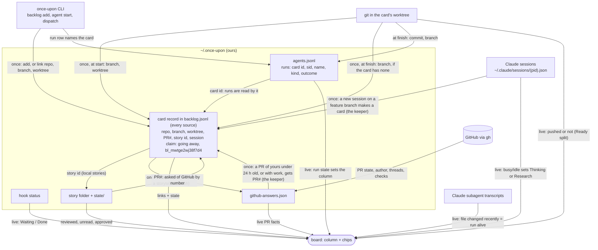

# ADR-29: One stored card record for every card source: a card is a row in backlog.jsonl whatever created it, and the board joins runs, sessions and works to that card

> Paths in this ADR are as of its date. The code has moved since; `docs/flows.md` and ADR-26 cite where it lives now.

Decided 11/17 by Eric (the fact walkthrough of 11/17, the plan and its two plan checks for `stored-card`; his answers of 11/18 and his decision on the PR window, 11/18 at about 12:40 PM ET), built in five branches (A to D1, below) and written up here on 11/23 as descriptive of the code on main at d969bc14. It supersedes [ADR-27](adr-27-implicit-cards-live-in-the-registry.md) in full (an implicit card is a stored card now), supersedes the claim paragraph of [ADR-25](adr-25-the-card-owns-its-runs.md) and its follow-up (a), and updates [ADR-26](adr-26-the-data-model.md) (the `backlog.jsonl` row, How the stores join, Who starts what, and the sentence that a board snapshot never writes). ADR-25's rule that a run names its card, and its phase table, stand.

## Context

Eric, 11/17: "get all of this into one single consistent data set, whether the card was created from the backlog or came from any of these other places."

Until this ADR one kind of card was a record: a `bl_` card in `backlog.jsonl`. Everything else the board showed was rebuilt on every read and joined by names:

- a PR, story, build-request or session-branch card was a `Work` (`board/src/stages/works.ts`), made from GitHub lists, story folders and `builds.json` on each build;
- an agent card was a ledger run (`stages/agents.ts`), and an implicit card (ADR-27) was only the `ic_` id on its first run's start row;
- a session card was a live session plus a branch lookup (`stages/sessions.ts`).

They met in `cardOnBranch` (repo and branch name equal, `state/src/queues/backlog/backlog.ts`) and in `agents.ts`'s own branch join. The 11/17 trace found the same fact (branch, repo, PR number, worktree, landing time) recorded three ways or not at all: the PR number was on no card, a finished card with no branch fell to row 7 and vanished, a started card with no session was shown Working on a guess, the claim lapsed silently after 2 h, and `landed_at` was the time of the write, not of the merge. ADR-27 had kept implicit cards out of `backlog.jsonl` for three reasons (11/6): `agent start` would write two files with no atomicity, `backlog.jsonl` had no incremental reader and would grow about 57 cards a day, and `records/` cannot write a file of the tier above it. Each has an answer now (Why ADR-27's reasons no longer hold).

## Decision

- **A card is one folded record, and every piece of work has one.** Whatever created it (`backlog add`, `agent start`, a session, a PR, a story, a build request), a card is an `add` event in `backlog.jsonl` and the later events on its id. The file keeps its name (ADR-26: a spelling change is a migration, so none is made). The id of a new card is `bl_` and a suffix whatever its source (`newId('bl')`). An `ic_` id already on run rows stays valid (`BACKLOG_ID_RE` is unchanged) and is stored by `card backfill`; nothing mints one any more.
- **The record.** What `BacklogItem` already had (id, title, note, repo, branch, state open|started|dropped, started_at, landed_at, landed_sha, hold, someday, added_by, added_at) plus:
  - `source`: `backlog` | `agent` | `session` | `pr` | `story`, what created it. Old rows read as `backlog`. It decides whether a card is listed (below), never a column.
  - `worktree`: the checkout the work is in (a path). `agent start` stores it only when git says the run's cwd is on the run's branch (a dispatched author starts in the main checkout and makes its worktree after, so there is none yet); dispatch links the verified worktree of a fixer; the keeper links the worktree a session is on. It defaults to the claim's, and finish reads it.
  - `pr`: the PR number, written only from a GitHub answer (or by `card link --pr N`, which checks gh's head branch), never from an agent's typed value; the repo is the card's.
  - `story`: the story id, written by the keeper from the story on the work, by a storyteller's finish or hand-back, and by `backlog edit --story` for a repair. Stories keep no card id (Eric, 11/17: a card exists long before any story).
  - `session`: the full id of the Claude session that made a `session` or `agent` card.
  - `landed_at` is the PR's GitHub `merged_at` when known: the `done` event carries it (`merged_at`), `at` stays the write time.
- **Runs are not stored on the card.** A run names its card (ADR-25) and the card's runs are read by that, as before. A copy would be a second source for a fact the registry already holds, and it could disagree. The run row is unchanged.
- **New events.** `add` takes `source`, `worktree`, `pr`, `story`, `session`. `link` is new: `{op:'link', id, repo?, branch?, worktree?, pr?, story?, session?, by}` sets only the fields it carries, on a card that is not dropped or landed, and never touches state, `started_at`, `landed_*` or `someday`. `done` takes `merged_at`. Schemas are lenient on read and strict on write (`backlog-events.ts`, `strict.ts`).
- **Who writes, and when.** The first writer to learn a fact writes it once, onto the card; a later identical fact writes nothing.

| Source | Writer | When | Writes |
|---|---|---|---|
| `backlog add` (CLI, board Add) | `BacklogStore.add` | on add | `add` source `backlog` |
| `agent start` with no `--card` (author, helper, research; not critic, fixer, storyteller) | `startRun` (core), before the run row | every start | `ensureCard` with source `agent`; the id goes on the run row. A start on a branch whose card is still open joins that card and says so (`--new-card` makes another). The registry no longer mints; a refused start leaves an idle `source: agent` card, which the board never shows and compaction removes |
| `agent start` on a card | `startRun` | after the registry accepts the start | `link` branch, repo and (when git agrees) worktree, as ADR-25's "run first, then the card" |
| `dispatch` of a fixer | `dispatchRun` | when it takes the card | `link` the fixer's worktree, the one it verified (`claimWorktreeProblem`) |
| `agent finish` | the registry's `finish`, and `finishRun`'s `beforeFinish` | every finish | an author's finish `done` reads git in the card's worktree (else the run's cwd) when it is on a feature branch equal to the run's: HEAD is the commit unless the typed `--commit` is HEAD or behind it; a typed commit that is not in its history is replaced, with a warning. The card with no branch takes the one git found, before the finish row |
| a live Claude session with no run of its own, on a feature branch of a repo GitHub's lookup answered for | the card keeper, after a board build | the first build that sees it | `ensureCard` source `session`, with its session id |
| a PR of yours opened in the last 24 hours, or a PR with work (a story or local story, a build in flight, a session on it) | the card keeper | the build that first sees it | `ensureCard` source `pr` (a PR GitHub answered for), else `story`, else `session`; or `link` on the card already on its branch |
| a story linked to a card | the keeper, a storyteller's finish and hand-back, `backlog edit --story` | when learned | `link story` |
| a merged PR | `MergeLander` (a listed card), the GitHub watcher (a stored card, by repo and PR number or story) | when GitHub says merged | `done` with `merged_at` and the merge sha |
| a deploy that contains the card's recorded commit | `landing.ts` | at deploy | `done` with the sha |

- **`ensureCard` is the one place a card is found or made.** Under the file's lock it looks for a card that is not dropped or landed by (1) an explicit id, (2) repo and PR number, (3) repo and branch (a feature branch only: `isFeatureBranch` refuses a default branch or a detached HEAD; among cards on one branch the one with a PR or story, then a listed one, then the oldest), (4) for a session card, the session; a hit is `link`ed with only what it lacked, a miss is an `add`. Two writers racing (a CLI start and the bridge's keeper) therefore make one card. The keeper never starts a new card on a branch whose card is another PR's, or a PR seen merged or closed: new work on a reused branch name is a new card.
- **Stored is not listed.** `BacklogStore.items()` is every stored card (a lookup by id reads it); `listed()` is the cards with `source` `backlog`, and every reader that decides what a card is or shows (the Backlog column, `backlog list`, doctor, landing, the editor's slots) takes `listed()`. A card is listed when someone added it or adopted it (`backlog adopt` links `source: backlog` onto the stored card instead of adding a second). Cards of the other sources are never drawn by themselves: they show only through a run, a work or a session that names them, so an agent card with no open run, no PR, no story and no live session is idle and invisible, a finished agent card ages out by the existing timers, and its record stays.
- **The keeper's rules are narrow** (Eric, 11/18). A PR is stored only when it has work, or is yours and was opened in the last 24 hours (`createdAt` from GitHub; `NEW_PR_MS`, `board/src/stages/learned.ts`). An old PR of yours and a PR waiting on your review with no work get no card; the board keeps finding them from GitHub's lists. This replaces the first draft's `card-keeper.json` ("opened after the keeper began"), which was a file to stop a restart carding every open PR: the 24 hour window bounds the same storm with no file, and survives deleting the home. At most 40 writes a build (the rest wait for the next), a failed card is left alone for 5 minutes and logged once, and a build that learns nothing new takes no lock and writes nothing.
- **The board reads stored cards.** A run that names a stored card nobody listed is one agent card; a session is placed by the card its runs name before it is guessed from its own branch; a stored card with a repo and PR number that no work has becomes a work (asked of GitHub by number, so a renamed head keeps its card, and `cardOnBranch` matches the PR number before the branch); a landed stored PR card is a merged work for the Done hour. The cardless-session branch join is gone; the started-card "Working" guess is gone (a started card nothing names is a Backlog card). PRs with no stored card are still rebuilt from GitHub's lists as before, so "the board stops rebuilding cards" holds for work only, which is why the title says what the board joins and not what it stops reading.
- **Live status stays read fresh.** PR state, draft, threads, checks, approvals, unread answers, story review state, session liveness, worktree scan facts and run states are never stored on the card. What is stored is what makes the join: ids and the one-time facts.
- **Landing is recorded once, on the card.** `landed_at` is `merged_at`; a second `done` can only move it earlier and keeps the first sha. `merged.json` is still read, for stories merged before this and for PRs no stored card holds; the inbox drop and the PR-state merged check for card-less PRs are unchanged.
- **Git is the truth for git facts.** At finish the commit, branch and push state come from git in the card's worktree. The agent still says when it is done and gives its outcome, question or findings. Any fact git cannot give (no checkout, gone, detached, slow, or a run that is not an author finishing `done`) falls back to what was typed, with no warning.
- **The build stays pure, and the bridge keeps the cards.** `buildBoard` returns what it learned (`LearnedCards`: works, sessions, PRs ended and open) beside the board and writes nothing; `Board` hands that to the card keeper after each build, and the keeper is the bridge's own writer, as the watcher is for `reviewed.json`. This is the one exception to ADR-26's "a board snapshot never writes", which now reads: the build writes nothing; `Board` writes through the keeper. No route that reads writes, and the CLI never calls the keeper (ADR-15). At bridge start, with the keeper on, `card backfill` (stored ids only, not `--cardless`) runs first, so the keeper never stores a second card on a branch an `ic_` card already holds.
- **Compaction keeps the file small.** `doctor --fix` drops a whole card (all its events) only when `source` is not `backlog`, no run in the retained `agents.jsonl` names it, no `move` names it as `before`, and it is closed (dropped or landed) more than 14 days ago, or is an idle `agent` or `session` card with no PR and no story whose latest event is that old and whose session is not live. A card with a PR or story goes only by closing.
- **The claim goes.** A card's owner is its latest open run. The `claim` and `assign` events are read as before and nothing is to write them; `liveClaim`, `CLAIM_GRACE_HOURS`, the "claimed, pending" Working and the "has no claim" refusal go. A second author is refused by the open-author check that already exists. An editor's slots read the run's launching `sid`. Not built yet (below): until it is, the claim is written and read as ADR-25 left it.
- **Wire shape.** `BoardCard.kind` stays `work | session | agent | backlog`, so the pages do not change.

### Where the card record comes from, and what the board reads

An arrow marked "once" is written onto the card the first time someone learns the fact, and a "live" one is read fresh on every board build, never stored. The card keeper reads GitHub's answers and the stories, not GitHub itself. The claim on the card is the part [Not built here](#built-and-not-built-here) says goes: card `bl_mwtge2wj38f7d4`.

### Migration (nothing is rewritten)

- `bl_` rows: no change; a fold defaults `source` to `backlog` and takes `worktree` from the claim. PR, story and session links are learned by the keeper as it sees them.
- `ic_` cards: `once-upon card backfill` appends an `add` (source `agent`, same id, its first run's task as title and note, repo, latest branch, time of its first run) for every `ic_` id on a start row that has no card; the bridge runs it at start. An adopted one already has its `add` and is left as it is. `doctor` warns (Stored cards) while any is missing.
- Runs with no card (the 170 of ADR-27's census and any since): `card backfill --cardless` groups the open ones and those ended within 7 days by `sid:name`, writes one card each and moves the runs to it with the existing `card` event (`agents.jsonl` is not rewritten). It moves runs on the board, so it is by hand, never at start. Older ones are shown nowhere and are left.
- Work, session and agent cards that were only ever rebuilt: no history exists; the keeper makes each from what is live at its first build, so a PR merged hours ago and no longer listed never gets a card.

### Why ADR-27's reasons no longer hold

1. Atomicity: `startRun` (core, which already imports both tiers) writes the card first and the run second. A refused start leaves a `source: agent` card with no run, which is idle, never shown, found again by the next start on that branch (`ensureCard`), and removed by compaction.
2. Incremental reading and growth: `backlogEventsIn` (`tailLog`) reads only the file's new bytes, and `doctor --fix` compacts `backlog.jsonl` by whole cards.
3. Tier: `records/` no longer mints; core writes the card.

## Built, and not built here

Built, one commit each: A (`stored-card`): the record, the filter, `ensureCard` and `link`, `agent start` storing its card, finish from git, `card link`. B (`stored-card-keeper`): compaction, the keeper in shadow, `card backfill`. C1 to C3: the board reads stored cards (agents, sessions, works), and every new card is a `bl_` card. D1: a merged PR lands once on its card.

Not built:

- **Dropping the claim** (the plan's step 9): the decision above stands, and `claim`, `liveClaim`, the "claimed, pending" Working and dispatch's claim write are as ADR-25 left them. It is card `bl_mwtge2wj38f7d4`.
- **Keying builds, inbox and `state/` by card id** (the plan's step 10, Eric's Q9): a follow-up card. It resolves card to `card.story` to the state key, with no folder renamed and no row rewritten (ADR-26: no spelling migration).
- **A session's second no-card start sharing the session's card:** joining the open card on the branch covers every start with a feature branch; a branchless helper or research start still gets a card of its own.
- **`backlog list --implicit`** keeps its name; it lists the `source: agent` cards no one adopted.

## Not changed

Stories, `state/` folders, inbox and builds are keyed as they are; the registry's file, events and the phase table; the Finish button's `finished-agents.json`; the claim events already on disk.

## Options considered

- **A second file `cards.jsonl` for non-backlog cards.** Keeps the human list small, but a card then has two homes and every join this ADR exists to remove comes back (`move`, `drop`, `adopt` across files).
- **Rename `backlog.jsonl` to `cards.jsonl`.** Cleaner name, but a rename is a migration of a live file and of every reader and doc. Not worth it; the name is documented.
- **Store the run list on the card.** Rejected above.
- **Write cards from a board read.** Breaks "a board snapshot never writes". The keeper writes after the build instead.
- **A `card-keeper.json` of the keeper's first run, so only PRs opened after it get a card.** Replaced by the 24 hour window.
- **SQLite** (ADR-25 D3): still not, the warning stands.

## Consequences

- One record per piece of work: `cat` and `jq` on `backlog.jsonl` answer "what is this work" for any card on the board that has work.
- A join by branch name stays only as the keeper's and `ensureCard`'s lookup when a fact is first learned; the board joins by the card's id, a PR number or a run's `card`.
- `backlog.jsonl` grows faster, so compaction shipped with the keeper.
- A wrong first write (a branch typed into a card by mistake) is read by everything; `card link` and `backlog branch` are the repair, and `doctor` lists the stored ids and runs that have no card.
