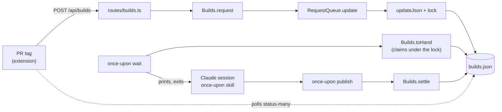
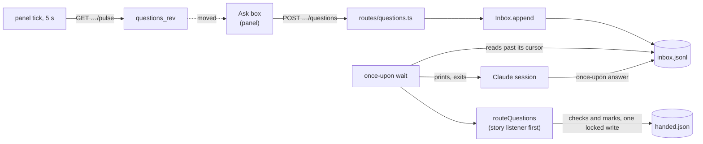
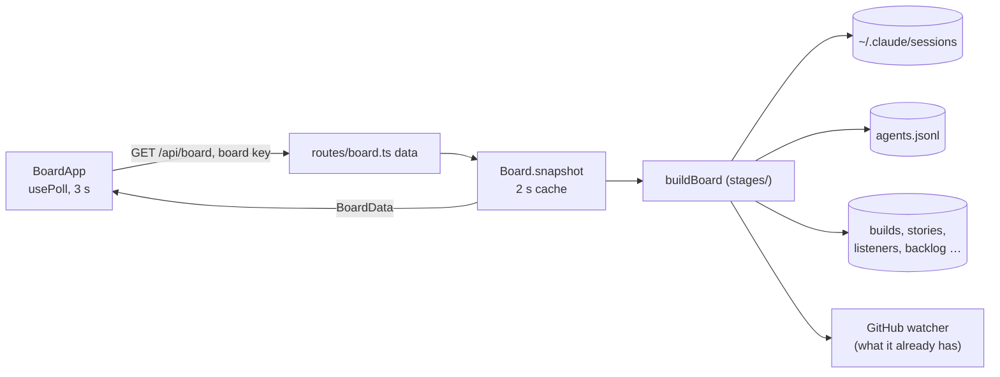
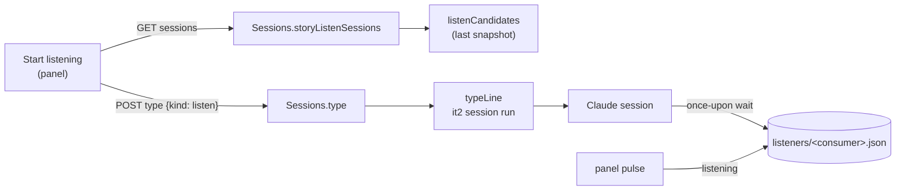
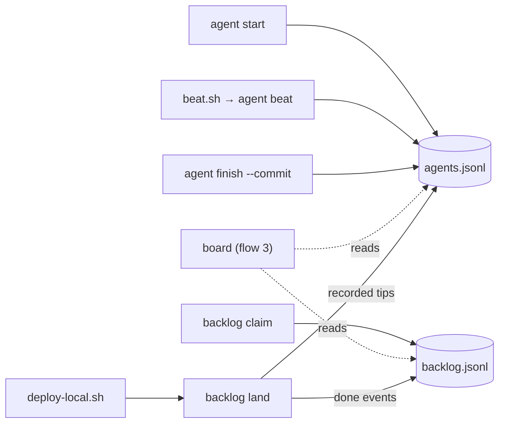

# Once Upon a Diff: request flows

Five requests, followed from the click or the command to the file written and back, as the code stands on main at 7fa8447 (11/4). Each hop names its layer and the line it happens on, so a reader can open the file at that line. [`state-map.md`](state-map.md) says what each file holds, and ADR-15 says why the layers are what they are.

1. [Build a story](#1-build-a-story)
2. [Ask](#2-ask)
3. [Board refresh](#3-board-refresh)
4. [Start listening](#4-start-listening)
5. [An agent's claim, through to its card landing](#5-an-agents-claim-through-to-its-card-landing)

## Reading the tables

Paths are from the repo root. After each `file:line` comes the name you'll find on that line.

| Layer | What it is |
|---|---|
| `app` | knows its host: the extension (content scripts, service worker), the board and local pages (`packages/web`), `packages/server` and `packages/cli` (the bridge's two apps) |
| `feature` | the panel (`packages/panel`), which an app hands its host through `PanelHost` |
| `client` | `packages/bridge-client` (the typed client and the poll) and `packages/ui-kit` |
| `contracts` | `packages/contracts`: the route table, the wire types and the schemas, over `packages/domain`, the pure rules that import nothing |
| `service` | the tiers of `packages/core/src/` (`foundation/`, `records/`, `queues/`, `features/`, `orchestration/`): the rules. No side effects of their own |
| `adapter` | `packages/core/src/adapters/`: every file write, program run and network call |
| `outside` | not this repo's code: a Claude Code session, a skill, `beat.sh`, `it2` |

Two things every HTTP hop shares, written once here:

- **Getting to the bridge.** The extension's content scripts never call the bridge. `callBridge` sends the service worker a message (`packages/extension/src/content/bridge.ts:52` (`chrome.runtime.sendMessage`)), the worker checks the route is one the extension may call (`packages/extension/src/entrypoints/background.ts:23` (`matchRoute`)) and fetches `127.0.0.1` with the token (`packages/extension/src/entrypoints/background.ts:33` (`fetch(`)). A page fetches with its own key instead: the board's transport is at `packages/web/public/board.ts:40` (`const transport`).
- **Inside the bridge.** One handler (`packages/server/src/index.ts:392` (`http.createServer`)) checks Host and Origin, serves pages, then checks the key (`packages/server/src/index.ts:441` (`checkApiCall(req, pathname, origin)`)). A bridge-wide route is found in `API_ROUTES` and run (`packages/server/src/index.ts:455` (`route.handle(call)`)). A story route goes through `storyCall` (`packages/server/src/index.ts:468` (`storyCall(call, storyMatch, scope)`)), which finds the story and runs its route (`packages/server/src/index.ts:389` (`route.handle(call, story)`)). Every handler that takes a body checks it with `parseBody` against the contracts package's schema before it acts.

## 1. Build a story

A reviewer clicks **Build story** on a PR's tag. The bridge only queues the request. A listening Claude session takes it, writes the story with the once-upon skill and publishes it, and the tag sees it ready.

**Ask for it**

| # | Layer | Hop | At |
|---|---|---|---|
| 1 | `app` | the tag's Build story click calls the typed client | `packages/extension/src/content/pr-tags.ts:126` (`ROUTES.buildRequest`) |
| 2 | `contracts` | the route: `POST /api/builds`, token only | `packages/contracts/src/bridge/routes.ts:27` (`buildRequest:`) |
| 3 | `app` | through the service worker to the bridge, as above | `packages/extension/src/entrypoints/background.ts:33` (`fetch(`) |
| 4 | `app` | the route checks the body and asks for the build | `packages/server/src/routes/builds.ts:36` (`parseBody('buildRequest', raw)`) |
| 5 | `service` | `Builds.request` checks the repo and number | `packages/core/src/queues/requests/builds.ts:350` (`request({`) |
| 6 | `service` | and changes `builds.json` in one locked step | `packages/core/src/queues/requests/builds.ts:368` (`this.queue.update(`) |
| 7 | `service` | `RequestQueue.update` | `packages/core/src/queues/requests/queue.ts:37` (`update<T>(`) |
| 8 | `adapter` | reads, changes and writes the file under its `O_EXCL` lock | `packages/core/src/adapters/stores/fs/lock.ts:104` (`export function updateJson`) |
| 9 | `adapter` | the lock: `builds.json.lock`, taken over when its pid is gone or it's 10 s old | `packages/core/src/adapters/stores/fs/lock.ts:81` (`export function withLock`) |
| 10 | `adapter` | **writes `builds.json`** through a temp file and a rename | `packages/core/src/adapters/stores/fs/json-file.ts:92` (`export function writeJsonAtomic`) |
| 11 | `app` | back: the route answers the request's state, and the tag shows Queued | `packages/server/src/routes/builds.ts:43` (`send(200, { state: build!.state`) |

**A listening session takes it**

| # | Layer | Hop | At |
|---|---|---|---|
| 12 | `app` | `once-upon wait --repo` (started by the once-upon-listen skill) enters the CLI | `packages/bridge/bin/once-upon.ts:13` (`main(process.argv.slice(2))`) |
| 13 | `app` | the command table runs `wait` | `packages/cli/src/index.ts:105` (`entry.run(home, loadConfig(home), opts)`) |
| 14 | `app` | each loop asks for build requests to hand over | `packages/cli/src/commands/inbox.ts:427` (`builds.toHand(consumer`) |
| 15 | `service` | `Builds.toHand` picks this wait's requests | `packages/core/src/queues/requests/builds.ts:306` (`toHand(`) |
| 16 | `service` | and claims them in the same locked write, so no other wait gets them | `packages/core/src/queues/requests/queue.ts:65` (`take(consumer: string`) |
| 17 | `app` | the wait prints the request and exits, which wakes the session | `packages/cli/src/commands/inbox.ts:468` (`printHandOver(entries, opts, relays, consumer)`) |
| 18 | `app` | with nothing to hand, it sleeps until the inbox file changes or 2 s pass | `packages/cli/src/commands/inbox.ts:314` (`watch(file`) |

**The story is written and published**

| # | Layer | Hop | At |
|---|---|---|---|
| 19 | `outside` | the once-upon skill gathers the PR with `gh`, writes the chapters and runs `story.mjs build`, which checks them and runs `once-upon publish` itself | `skills/once-upon/bin/story.ts:443` (`'publish',`) |
| 20 | `app` | `publish`, run by `story.ts build` | `packages/cli/src/commands/stories.ts:210` (`function publish(`) |
| 21 | `service` | places the story's folder: `.once-upon/<id>/` in the repo's checkout when the bridge knows it, else `~/.once-upon/<id>/` | `packages/core/src/features/publishing/publish.ts:87` (`storyDirFor(home, id, { repo })`) |
| 22 | `service` | **copies `chapters.json` and `file-map.json`** into that folder, through the adapter's `copyFileAtomic` | `packages/core/src/features/publishing/publish.ts:102` (`copyFileAtomic(`) |
| 23 | `service` | **writes `meta.json`** last, with the head it was told from, through the adapter's `writeJsonAtomic` | `packages/core/src/features/publishing/publish.ts:106` (`writeJsonAtomic(path.join(dest, 'meta.json')`) |
| 24 | `service` | settles the build request | `packages/core/src/features/publishing/publish.ts:125` (`builds.settle(`) |
| 25 | `service` | `settle` finishes it under the lock, if the story matches the request | `packages/core/src/queues/requests/builds.ts:508` (`settle(`) |

**The tag sees it**

| # | Layer | Hop | At |
|---|---|---|---|
| 26 | `app` | the PR tags poll the status of every PR on the page | `packages/extension/src/content/pr-tags.ts:81` (`ROUTES.statusMany`) |
| 27 | `app` | the route finds each story, and settles a request its head matches | `packages/server/src/routes/catalog.ts:126` (`async function statusMany(`) |
| 28 | `app` | it asks the service's `storyFinishes`, the same rule `publish` used, then settles under the lock | `packages/server/src/routes/catalog.ts:78` (`storyFinishes(build, storyHead)`) |

The tag turns to Ready. On `/changes` the panel loads `GET /api/stories/<id>` and docks.

**From the board instead.** A card with a session and a PR but no story has its own Build story. It doesn't queue a request: it types the skill's line into that session's tab.

| # | Layer | Hop | At |
|---|---|---|---|
| B1 | `app` | the card's button, after a confirm | `packages/web/public/board/columns/card.ts:99` (`typeInto(api, 'build'`) |
| B2 | `app` | `POST /api/board/type {kind: 'build'}` with the board's key | `packages/web/public/board/columns/actions.ts:19` (`ROUTES.boardType`) |
| B3 | `app` | the route hands it to the Sessions service | `packages/server/src/routes/board.ts:81` (`app.sessions.type(`) |
| B4 | `service` | checks the session is at its prompt, and takes the prompt from the card the board built | `packages/core/src/features/sessions/sessions.ts:259` (`build?.session === sessionId`) |
| B5 | `adapter` | **types the line** into the tab: `it2 session run` | `packages/core/src/adapters/iterm.ts:159` (`'session', 'run'`) |

The click names its card (`card` in the body), so a session that builds for several cards, such as a launcher with three finished authors, gets the clicked card's line (`packages/core/src/features/sessions/sessions.ts:262` (`one.id === card`)). On a finished author's own card in Ready for your review, the line is a plain request naming the branch and its worktree, typed into the session that launched the author, never the slash command: that session decides who runs the skill (`packages/core/src/features/sessions/listening.ts:352` (`function authorBuild`)). When it can't be typed, the card's Copy hands over the line.

**Review, without a story.** A card with a branch and no story or PR, whose work hasn't shipped (a finished author's commit, or a session alone on an unmerged branch), has **Review**. The bridge makes a storyless review: a by-folder local story over the branch's own commits. It opens on the local page, which has the diff, Create pull request and Push, and no Approve. There, seeing the diff and clicking Push or Create pull request is the approval. A told story keeps Approve before Push.

| # | Layer | Hop | At |
|---|---|---|---|
| R1 | `app` | the card's Review button | `packages/web/public/board/columns/actions.ts:47` (`reviewCard`) |
| R2 | `contracts` | `POST /api/board/review {card}`, the board's key | `packages/contracts/src/board/routes.ts:59` (`boardReview:`) |
| R3 | `app` | the route finds the card in the board's own snapshot. The branch and folder are the card's, never the body's | `packages/server/src/routes/board.ts:121` (`async function review`) |
| R4 | `service` | the base is the merge-base with origin's default branch, the head the branch's name | `packages/core/src/records/stories/local-story.ts:201` (`export function reviewBranch`) |
| R5 | `service` | **writes the story** in the checkout's `.once-upon/`, as `once-upon local` with no chapters does | `packages/core/src/records/stories/local-story.ts:90` (`export function createLocalStory`) |
| R6 | `app` | Push on a storyless review sends the head the diff was drawn at, with no Approve. Create pull request refuses a branch that has moved past it | `packages/server/src/routes/push.ts:34` (`isStoryless(story.dir)`) |

## 2. Ask

A reviewer types a question in the panel's Ask box. It goes into the inbox log, a listening session's wait hands it over, the session answers from the terminal, and the panel's pulse sees the answer.

| # | Layer | Hop | At |
|---|---|---|---|
| 1 | `feature` | the Ask form's submit calls the host's `ask` | `packages/panel/src/ask/questions.ts:523` (`await opts.ask({`) |
| 2 | `feature` | on the local page, `ask` is the panel's shared bridge option | `packages/panel/src/host/bridge-options.ts:41` (`ask: (question) =>`) |
| 2' | `app` | on GitHub, the extension supplies its own `ask` over the service worker | `packages/extension/src/content/pages/files-changed.ts:160` (`ROUTES.questionAsk`) |
| 3 | `contracts` | the route: `POST /api/stories/<id>/questions`, any key of the story's | `packages/contracts/src/story/routes.ts:49` (`questionAsk:`) |
| 4 | `app` | the story route checks the body and appends the question | `packages/server/src/routes/questions.ts:66` (`app.inbox.append(`) |
| 5 | `service` | `Inbox.append` gives it an id and a time | `packages/core/src/queues/requests/inbox.ts:149` (`append<E`) |
| 6 | `adapter` | **appends a line to `inbox.jsonl`** | `packages/core/src/adapters/stores/fs/files.ts:24` (`export function appendText`) |
| 7 | `app` | a running `wait` wakes on the file change and reads past its cursor | `packages/cli/src/commands/inbox.ts:397` (`messages.unread(consumer, { advance: true })`) |
| 8 | `service` | `unread` reads from the cursor's byte offset and **writes the cursor** (`cursors/<consumer>.json`) | `packages/core/src/queues/requests/inbox.ts:248` (`unread(`) |
| 9 | `app` | which questions this wait takes | `packages/cli/src/commands/inbox.ts:151` (`function questionsToTake(`) |
| 10 | `service` | routing, and **writes `handed.json`** under `handed.json.lock`: a question another wait has is skipped, a story's own live listener beats a repo listener (which defers to it), and each question taken is marked as this wait's in the same locked write, so two waits can't both take it | `packages/core/src/queues/requests/conversation.ts:340` (`updateJson<Handed, void>(handedFile(home)`) |
| 11 | `service` | a story built by an agent this session launched is relayed to that agent | `packages/core/src/records/listeners/binding.ts:171` (`export function relayBinding`) |
| 12 | `service` | marks again under the lock once the relays are known: a relayed question is noted as `via` the agent, so `answer` credits the right session | `packages/core/src/queues/requests/conversation.ts:147` (`export function noteHanded`) |
| 13 | `service` | **writes the `handling` beat** (`listeners/<consumer>.json`) | `packages/core/src/records/listeners/listeners.ts:65` (`export function beat(`) |
| 14 | `app` | prints the question (with the relay message when it has one) and exits | `packages/cli/src/commands/inbox.ts:468` (`printHandOver(entries, opts, relays, consumer)`) |
| 15 | `outside` | the session answers in chat and runs `once-upon answer --question <id> --file …` |  |
| 16 | `app` | `answer` **appends an `answer` line** to `inbox.jsonl` | `packages/cli/src/commands/inbox.ts:539` (`messages.append({`) |
| 17 | `feature` | back: the panel's one clock, every 5 s while the tab shows | `packages/panel/src/shell/overlay.ts:257` (`setInterval(`) |
| 18 | `feature` | one pulse call a tick | `packages/panel/src/host/bridge-options.ts:66` (`ROUTES.storyPulse`) |
| 19 | `app` | the pulse rereads the inbox and answers a rev per part | `packages/server/src/routes/story.ts:93` (`questions_rev: revOf(questions)`) |
| 20 | `feature` | the rev moved, so only the questions are fetched again | `packages/panel/src/shell/overlay.ts:236` (`moved('questions_rev')`) |

## 3. Board refresh

The board page polls `GET /api/board` every 3 s while it's visible and on window focus. The bridge answers from a 2 s cache, or builds the board in stages from a dozen sources.

| # | Layer | Hop | At |
|---|---|---|---|
| 1 | `app` | the page's root component polls the board route | `packages/web/public/board.ts:143` (`usePoll(() => bridge.ask(ROUTES.board)`) |
| 2 | `client` | `usePoll`, the Preact hook | `packages/bridge-client/src/use-poll.ts:14` (`export function usePoll`) |
| 3 | `client` | over `createPoll`: a timer while visible, and the window's focus | `packages/bridge-client/src/poll.ts:68` (`setInterval(`) |
| 4 | `contracts` | the route: `GET /api/board`, the token or the board's key | `packages/contracts/src/board/routes.ts:10` (`board: api<undefined, BoardData>`) |
| 5 | `app` | the page's transport sends its key (the `#key=` fragment, or the cookie on a proxy name) | `packages/web/public/board.ts:43` (`fetch(path`) |
| 6 | `app` | the bridge recognizes the board's key (`packages/server/src/index.ts:295` (`sameToken(auth, boardKey(token))`)), and lets it reach only the routes whose table entry allows it; any other route is a 403 | `packages/server/src/index.ts:451` (`boardKeyMay(candidate.route)`) |
| 7 | `app` | the route | `packages/server/src/routes/board.ts:53` (`app.board.snapshot()`) |
| 8 | `service` | a 2 s cache, one build in flight for every caller, and a generation so a stale build can't refill it | `packages/core/src/orchestration/board/board.ts:183` (`async snapshot()`) |
| 9 | `service` | the build gathers its context and runs the stages | `packages/core/src/orchestration/board/board.ts:374` (`buildBoard(ctx`) |
| 10 | `service` | the stages, in order | `packages/core/src/orchestration/board/stages/index.ts:85` (`export async function buildBoard`) |
| 11 | `service` | live sessions, their status, branches and repos | `packages/core/src/orchestration/board/stages/sessions.ts:56` (`liveSessions(settings.sessionsDir)`) |
| 12 | `adapter` | **reads `~/.claude/sessions/<pid>.json`**, live pids only | `packages/core/src/adapters/claude-sessions/live-sessions.ts:39` (`export async function liveSessions`) |
| 13 | `service` | the agents, from the registry | `packages/core/src/orchestration/board/stages/sessions.ts:62` (`readAgents(`) |
| 14 | `service` | **reads `agents.jsonl`** and folds its events into one view per agent. (Nothing else is read: the ledger and progress files are logs the registry writes, not input.) | `packages/core/src/records/agents/read.ts:26` (`foldAgentEvents(parseAgentEvents(readAgentsFile(`) |
| 15 | `service` | the works: PR and local stories, pending builds | `packages/core/src/orchestration/board/stages/index.ts:94` (`collectWorks(ctx)`) |
| 16 | `service` | what else is known of each session: listeners, voice, blank sessions, titles, status lines | `packages/core/src/orchestration/board/stages/index.ts:102` (`readSessionFacts(`) |
| 17 | `service` | cards for the works, with PR details from what the GitHub watcher last heard | `packages/core/src/orchestration/board/stages/index.ts:124` (`buildCards(`) |
| 18 | `service` | each card's column | `packages/core/src/orchestration/board/stages/cards.ts:252` (`columnOf({`) |
| 19 | `service` | the column rules | `packages/core/src/orchestration/board/columns.ts:80` (`export function columnOf`) |
| 20 | `service` | the Backlog's items, folded from **`backlog.jsonl`** (claims included) | `packages/core/src/orchestration/board/stages/index.ts:127` (`state.backlog.items()`) |
| 21 | `service` | which agent claimed which Backlog card | `packages/core/src/orchestration/board/stages/index.ts:139` (`claimViews(`) |
| 22 | `service` | the lanes, by repo | `packages/core/src/orchestration/board/stages/index.ts:258` (`groupLanes(cards, labels)`) |
| 23 | `contracts` | back: the answer's shape | `packages/contracts/src/board/types.ts:10` (`export interface BoardData`) |
| 24 | `app` | the root component draws the regions, and Preact's keyed diff keeps focus, scroll and typed text | `packages/web/public/board.ts:246` (`<${Columns} view=${columns} />`) |

The column regions are split by card type under `packages/web/public/board/columns/` (`layout`, `card`, `agent`, `actions`, `blank`, `listeners`, `editors`, with `columns.ts` putting the columns together).

## 4. Start listening

A reviewer clicks **Start listening** under the Ask box (or on a PR page's notice, or the board). The bridge finds an idle session in the repo's checkout and types `/once-upon-listen <repo>` (or `--story <id>`) into its iTerm tab. The session's wait then beats, and the panel's light turns green.

| # | Layer | Hop | At |
|---|---|---|---|
| 1 | `feature` | the panel's button asks the host for sessions | `packages/panel/src/components/status-light-part.ts:111` (`opts.listen!.sessions(target)`) |
| 2 | `client` | none, one, or a chooser | `packages/ui-kit/src/listen.ts:20` (`export function listenPlan`) |
| 3 | `app` | on GitHub: `GET /api/board/listen-sessions`, with the token through the service worker | `packages/extension/src/content/listen.ts:50` (`ROUTES.boardListenSessions`) |
| 3' | `app` | on the local page: the story's own route, with the story's key (the board's routes need the board's key) | `packages/web/public/local/mount.ts:107` (`ROUTES.storyListenSessions`) |
| 4 | `app` | the board route | `packages/server/src/routes/board.ts:91` (`app.sessions.storyListenSessions(storyId)`) |
| 4' | `app` | the story route, still through `Board`'s one-line delegate (ADR-16) | `packages/server/src/routes/story.ts:201` (`app.board.storyListenSessions(story.id)`) |
| 5 | `service` | the story's repo, then the idle sessions in its checkout | `packages/core/src/features/sessions/sessions.ts:165` (`async storyListenSessions(`) |
| 6 | `service` | candidates from the last board snapshot: never the voice session or one already listening | `packages/core/src/features/sessions/listening.ts:204` (`export function listenCandidates`) |
| 7 | `feature` | the reviewer picks (or there's one): the host's `start` | `packages/panel/src/components/status-light-part.ts:90` (`opts.listen!.start(`) |
| 8 | `app` | on GitHub: `POST /api/board/type {kind: 'listen'}` | `packages/extension/src/content/listen.ts:59` (`ROUTES.boardType`) |
| 8' | `app` | on the local page: `POST /api/stories/<id>/listen`, then the delegate | `packages/server/src/routes/story.ts:212` (`app.board.type('listen'`) |
| 9 | `app` | the board route | `packages/server/src/routes/board.ts:81` (`app.sessions.type(`) |
| 10 | `service` | `Sessions.type`: is the session at its prompt | `packages/core/src/features/sessions/sessions.ts:220` (`this.typeable(sessionId)`) |
| 11 | `service` | the same rule as the offer, against a fresh snapshot | `packages/core/src/features/sessions/sessions.ts:223` (`await this.feed.snapshot()`) |
| 12 | `service` | the bridge makes the line itself, and the body never carries text: `/once-upon-listen <repo>` for the repo, or `--story <id>` for the story scope (`packages/core/src/features/sessions/listening.ts:337` (`export const listenStoryPromptFor`), chosen at `packages/core/src/features/sessions/sessions.ts:248` (`listenStoryPromptFor(story)`)) | `packages/core/src/features/sessions/listening.ts:334` (`export const listenPromptFor`) |
| 13 | `adapter` | **types it** into the tab found from the session's tty | `packages/core/src/adapters/iterm.ts:150` (`export async function typeLine`) |
| 14 | `outside` | the session runs the once-upon-listen skill, which starts `once-upon wait` in the background |  |
| 15 | `app` | the wait **writes its `waiting` beat** every 5 s | `packages/cli/src/commands/inbox.ts:388` (`beat(home, consumer, 'waiting', scope)`) |
| 16 | `app` | back: the pulse says whether a listener is live for the story or its repo | `packages/server/src/routes/story.ts:86` (`listeningOf(app.home`) |
| 17 | `feature` | the light turns green | `packages/panel/src/shell/overlay.ts:248` (`moved('listening')`) |

## 5. An agent's claim, through to its card landing

A launching session registers an agent and claims a Backlog card for it. The agent beats as it works and finishes with the commit it made. A deploy then marks the card done by that commit, never by a branch name. Every step is a CLI command over append-only files: no HTTP.

**Register and claim**

| # | Layer | Hop | At |
|---|---|---|---|
| 1 | `app` | `once-upon agent start <name> --kind author --card <id> …` | `packages/cli/src/commands/agent.ts:75` (`registry.start({`) |
| 2 | `service` | `AgentRegistry.start` checks the fields and gives the run an id | `packages/core/src/records/agents/registry.ts:231` (`start(input: StartInput)`) |
| 3 | `adapter` | **appends a `start` event to `agents.jsonl`** | `packages/core/src/adapters/stores/agents-file.ts:12` (`export function appendAgentEvent`) |
| 4 | `service` | and a log line to the ledger file through the adapter's `appendLine`, when `board_ledger_file` is set (a mirror for the status line, the iTerm hook and people; the board never reads it) | `packages/core/src/records/agents/registry.ts:172` (`appendLine(this.mirror.ledger`) |
| 5 | `app` | `once-upon backlog claim <id> --agent <name> --branch <b>` | `packages/cli/src/commands/backlog.ts:131` (`store.claim(item.id`) |
| 6 | `service` | `BacklogStore.claim` refuses a dropped card | `packages/core/src/queues/backlog/backlog.ts:365` (`claim(`) |
| 7 | `adapter` | **appends a `claim` event to `backlog.jsonl`** | `packages/core/src/adapters/stores/backlog-file.ts:12` (`export function appendBacklogEvent`) |
| 8 | `app` | `--branch` also starts the card on that branch | `packages/cli/src/commands/backlog.ts:134` (`store.start(item.id`) |

**Work and beats**

| # | Layer | Hop | At |
|---|---|---|---|
| 9 | `outside` | the agent runs `beat.sh <name> N/M <step> "<note>"`, which writes the progress line and calls `once-upon agent beat … --no-mirror` |  |
| 10 | `app` | `agent beat` | `packages/cli/src/commands/agent.ts:118` (`registry.beat(`) |
| 11 | `service` | **appends a `beat` event** | `packages/core/src/records/agents/registry.ts:298` (`beat(name: string`) |
| 12 | `service` | the board reads both files on each build (flow 3, hops 13–14 and 20): the claimed card sits in Working with its agent on it | `packages/core/src/orchestration/board/stages/agents.ts:99` (`export function claimViews(`) |
| 13 | `service` | once the author finishes, the card waits for its critic before Ready to ship (the rules: `packages/core/src/queues/backlog/claims.ts:167` (`export function criticHold(`)) | `packages/core/src/orchestration/board/stages/backlog.ts:230` (`criticHold(item, author, agents, nowMs)`) |

**Finish and land**

| # | Layer | Hop | At |
|---|---|---|---|
| 14 | `app` | `once-upon agent finish <name> --state done --commit <sha> --branch <b> --card <id>` | `packages/cli/src/commands/agent.ts:126` (`registry.finish(`) |
| 15 | `service` | **appends a `finish` event** with the commit as its result | `packages/core/src/records/agents/registry.ts:317` (`finish(name: string`) |
| 16 | `outside` | the main session deploys: `scripts/deploy-local.sh --yes <branch>` fast-forwards main and restarts the bridge |  |
| 17 | `app` | after the deploy, the script runs `backlog land` over the range that went live | `scripts/deploy-local.sh:287` (`backlog land`) |
| 18 | `app` | `land` reads the commit each agent's finish recorded | `packages/cli/src/commands/backlog.ts:178` (`recordedTips(registry.events())`) |
| 19 | `service` | the last recorded commit per card | `packages/core/src/queues/backlog/landing.ts:20` (`export function recordedTips`) |
| 20 | `service` | which cards' commits went live: the recorded tip itself is in the range; or a commit with its patch id is (a rebase or a clean pick); or, for a batch deploy's picked sha whose patch changed, the commit with the tip's author stamp (`packages/core/src/queues/backlog/landing.ts:110` (`const pickOf`)) | `packages/core/src/queues/backlog/landing.ts:86` (`export function landItems(`) |
| 21 | `adapter` | `git rev-list` over the range | `packages/core/src/adapters/git.ts:160` (`export function commitsInRange(`) |
| 22 | `app` | each matched card is marked done at its sha | `packages/cli/src/commands/backlog.ts:186` (`store.done(item.id, { sha`) |
| 23 | `service` | **appends a `done` event** to `backlog.jsonl` | `packages/core/src/queues/backlog/backlog.ts:453` (`done(id: string`) |

A card the script couldn't match is printed, to close by hand with `once-upon backlog done <id> --sha <sha>`. A card held with `backlog hold` is never marked by a deploy.
